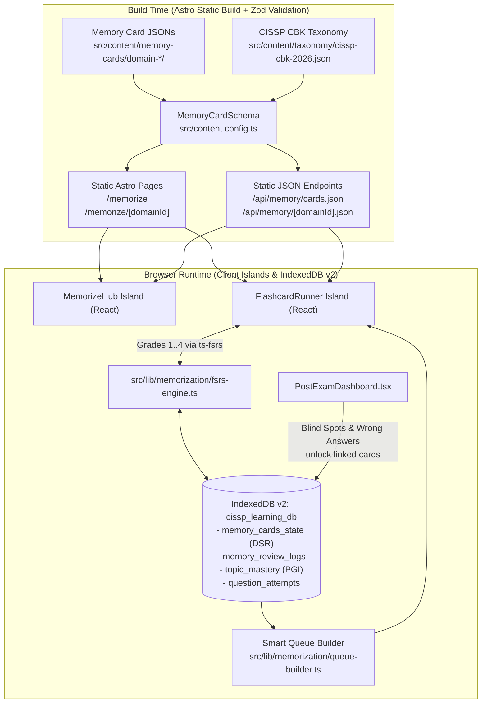

# CISSP Memorization & Spaced Repetition System — Architecture & Content Specification

**Repository**: `D:\git\learn-cissp`  
**Status**: Canonical Specification & Implementation Plan  
**Companion to**: [VISION_AND_AGENT_PLAYBOOK.md](file:///D:/git/learn-cissp/docs/VISION_AND_AGENT_PLAYBOOK.md) · [QUESTION_DATA_SPEC.md](file:///D:/git/learn-cissp/docs/QUESTION_DATA_SPEC.md)  
**Stack**: Astro 5 (Static Output) · TypeScript · React 19 Islands · `ts-fsrs` (FSRS-6 DSR Engine) · Dexie (IndexedDB v2) + LocalStorage

---

## 1. Executive Vision & Algorithm Selection

`learn-cissp` already diagnoses *what* a candidate gets wrong and *why* (`trapType`, Confidence vs. Accuracy quadrants, Priority Gap Index). However, passing the ISC2 CISSP exam also requires **instant, automatic recall** of strict hierarchies, quantitative formulas, legal/audit distinctions, protocol port/layer mappings, cryptographic properties, and sibling-concept contrasts across all **8 Domains and 58 Sub-domains**.

This specification defines a **100% browser-local, scientifically grounded Memorization & Spaced Repetition System (SRS)** tailored specifically for CISSP concepts and tightly coupled to `learn-cissp`'s existing diagnostic engine.

### 1.1 Evolution of Spaced Repetition Models & Selection Rationale

| Method | Mathematical Core | Personalization | Strengths | Limitations / Why Not Primary | CISSP Suitability |
|---|---|---|---|---|---|
| **Ebbinghaus Curve** | $R = e^{-t/S}$ | Conceptual foundation | Defines Retrievability ($R$), Stability ($S$), and elapsed time ($t$) | Exponential decay under-predicts long-term retention tails vs. power-law curves | Foundation only |
| **Leitner System** | Discrete boxes ($2^n$ days) | None | Zero computation; easy with physical index cards | Coarse intervals; resets hard cards all the way to Box 1 | Too rigid for 58 sub-domains |
| **SuperMemo SM-2** | $I_n = I_{n-1} \cdot EF$, quadratic $EF'$ update ($1.3$ floor) | Per-card Easiness Factor ($EF$) | Lightweight; historically proven | Hardcoded magic constants; triggers **"ease hell"** on complex CISSP models (e.g., Bell-LaPadula vs. Biba) | Suboptimal; creates review burnout |
| **Half-Life Regression (HLR)** | $h = 2^{w \cdot x}$ (exponential decay + feature weights) | Content & user history features | Models intrinsic item complexity from content features | Primarily trained on vocabulary; lacks explicit Difficulty/Stability separation | Useful only as an initial difficulty prior |
| **SSP-MMC** | Markov Decision Process + Dynamic Programming over DSR | Cost-optimal policy for target retention | Minimizes total lifetime study effort | Heavy offline DP table generation; less flexible for ad-hoc exam crunch dates | Inspiration for queue prioritization |
| **DASH** | IRT Ability + exponentially decayed practice history windows | Student ability + practice recency | Bridges practice performance and memory decay across tasks | Does not natively output next-day review intervals by itself | Ideal for **Exam $\leftrightarrow$ SRS coupling** |
| **FSRS (v5 / v6)** | **DSR Power-Law Model** + 21 trainable parameters (Binary Cross-Entropy / Adam) | Full DSR per card + optional per-user parameter fit | Eliminates "ease hell"; reduces daily workload by **20%–30%** at equal retention; exact target-retention scheduling | Requires initial default weights until user builds review history | **Primary Scheduling Engine** |

### 1.2 Chosen Architecture: Hybrid FSRS-6 + HLR Priors + DASH Exam-Coupling

We adopt a **three-layer hybrid engine** designed for zero-backend browser execution:

1. **Core Scheduler — FSRS-6 (`ts-fsrs`)**:
   Uses the official open-source **Free Spaced Repetition Scheduler** (DSR model) with power-law forgetting curves and user-tunable target retention ($R_{\text{req}}$).
2. **Content-Feature Prior (HLR-inspired Seeding)**:
   Every authored memory card declares an `intrinsicDifficulty` ($d_{\text{card}} \in \{1..10\}$) and `examPriority` (`must_know` | `high_yield` | `deep_detail`) in JSON so notoriously dense CISSP items (e.g., Kerberos 6-step ticket exchange, Common Criteria EALs, IPsec AH vs. ESP) start with realistic initial difficulty before the user has any review history.
3. **DASH Cross-Signal Bridge (Exam $\leftrightarrow$ Memory Coupling)**:
   Connects IndexedDB `question_attempts` and `topic_mastery` directly to the SRS queue:
   - Missing an exam question — especially a **High-Confidence Error (Blind Spot)** or **Low-Confidence Correct (Lucky Guess)** — automatically unlocks/flags linked memory cards (`unlockedByExamGap: true`) and boosts their scheduling urgency using the sub-domain's **Priority Gap Index ($\text{PGI}$)**.
   - Completing a sub-domain exam surfaces targeted memory cards directly inside `PostExamDashboard.tsx`.

---

## 2. Mathematical Specification (FSRS-6 DSR Model)

Each card $c$ maintains a **DSR state** in IndexedDB:
- **$D \in [1, 10]$ (Difficulty)**: How inherently hard this concept is for this learner to retain.
- **$S > 0$ (Stability, in days)**: The exact elapsed time (in days) for Retrievability $R$ to fall from $100\%$ to $90\%$.
- **$R \in [0, 1]$ (Retrievability)**: Current instantaneous probability of recalling the card after $t$ elapsed days since `lastReviewAt`.

### 2.1 Power-Law Forgetting Curve & Target Retention Solver

Unlike classical Ebbinghaus exponential decay ($R = e^{-t/S}$), FSRS models human memory decay using a tunable power-law curve (defaulting to FSRS-5/6 standard parameters):

$$R(t, S) = \left(1 + \text{FACTOR} \cdot \frac{t}{S}\right)^{\text{DECAY}}$$

where:
- $\text{DECAY} = -w_{20}$ (default $-0.5$, or $-0.5$ in FSRS-4.5/5; parameterized in FSRS-6 via trainable parameter $w_{20} > 0$)
- $\text{FACTOR} = 0.9^{1/\text{DECAY}} - 1$ (which guarantees $R(S, S) = 0.90$; when $\text{DECAY} = -0.5$, $\text{FACTOR} = \frac{19}{81} \approx 0.2345679$)

Solving $R(I, S) = R_{\text{req}}$ in reverse yields the exact next review interval $I$ (in days) for a user's chosen **Target Retention** $R_{\text{req}} \in [0.75, 0.97]$:

$$I(S, R_{\text{req}}) = \max\left(1, \text{round}\left(\frac{S}{\text{FACTOR}} \cdot \left(R_{\text{req}}^{1/\text{DECAY}} - 1\right)\right)\right)$$

> **CISSP Study Presets for $R_{\text{req}}$**:
> - **Standard Mastery (`0.90`)**: Balanced daily workload (default).
> - **Exam Crunch Mode (`0.93`–`0.95`)**: Compresses intervals during the final 2–4 weeks before the exam date.
> - **Maintenance Mode (`0.85`)**: Low daily volume for already-mastered domains (`masteryTier === 'mastered'`).

### 2.2 State Transition Equations on Review

When a user grades a card with rating $G \in \{1\text{ (Again)}, 2\text{ (Hard)}, 3\text{ (Good)}, 4\text{ (Easy)}\}$:

1. **Initial State (First Review of a New Card)**:
   - Initial Stability: $S_0(G) = w_{G-1}$
   - Initial Difficulty (blended with card's authored `intrinsicDifficulty` $d_{\text{card}}$):
     $$D_0^{\text{fsrs}}(G) = w_4 - e^{w_5 \cdot (G - 1)} + 1$$
     $$D_0 = \text{clamp}_{[1, 10]}\left(0.75 \cdot D_0^{\text{fsrs}}(G) + 0.25 \cdot d_{\text{card}}\right)$$
     *(Note: Blending $25\%$ of the authored `intrinsicDifficulty` prior prevents brand-new hard cards from receiving overly optimistic intervals on first pass, while yielding completely to FSRS history on subsequent reviews.)*

2. **Difficulty Update (with Mean Reversion to Prevent "Ease Hell")**:
   $$\Delta D = -w_6 \cdot (G - 3)$$
   $$D_{\text{linear}} = D + \Delta D \cdot \frac{10 - D}{9}$$
   $$D' = \text{clamp}_{[1, 10]}\left(w_7 \cdot D_0^{\text{fsrs}}(4) + (1 - w_7) \cdot D_{\text{linear}}\right)$$

3. **Stability After Successful Recall ($G \in \{2, 3, 4\}$)**:
   $$S'_{\text{recall}}(D, S, R, G) = S \cdot \left(e^{w_8} \cdot (11 - D) \cdot S^{-w_9} \cdot \left(e^{w_{10}(1 - R)} - 1\right) \cdot \alpha_{\text{hard}} \cdot \alpha_{\text{easy}} + 1\right)$$
   where $\alpha_{\text{hard}} = w_{15}$ if $G = 2$ (else $1$), and $\alpha_{\text{easy}} = w_{16}$ if $G = 4$ (else $1$).

4. **Stability After Lapse / Forgetting ($G = 1$, "Again")**:
   $$S'_{\text{forget}}(D, S, R) = \min\left(S,\; w_{11} \cdot D^{-w_{12}} \cdot \left((S + 1)^{w_{13}} - 1\right) \cdot e^{w_{14}(1 - R)}\right)$$
   *(Unlike SM-2, FSRS never collapses a well-learned card's difficulty permanently to a dead-end floor; $S'$ scales gracefully with prior stability $S$ and elapsed forgetting $1 - R$.)*

### 2.3 Optional Client-Side Parameter Optimization (Web Worker)

- By default, all learners start with **FSRS-5/6 default weights** (validated across millions of Anki review logs).
- Once a learner accumulates $\ge 400$ entries in IndexedDB `memory_review_logs`, an optional **"Optimize My Memory Model"** action runs inside a **Web Worker** (`src/lib/memorization/optimizer.worker.ts`):
  - Minimizes Binary Cross-Entropy (log loss) over the user's local review sequences:
    $$\mathcal{L}(w) = -\frac{1}{N} \sum_{i=1}^{N} \left[y_i \ln(\hat{R}_i) + (1 - y_i) \ln(1 - \hat{R}_i)\right]$$
    where $y_i \in \{0, 1\}$ ($0$ for `Again`, $1$ for `Hard/Good/Easy`) and $\hat{R}_i = R(t_i, S_i; w)$.
  - Stores fitted weights in `localStorage['cissp:fsrs_user_params']` (exported/imported with backups). Zero network calls.

---

## 3. Technology Stack & Architectural Integration

### 3.1 Library & Runtime Choices

| Concern | Technology Choice | Rationale |
|---|---|---|
| **FSRS Engine** | **`ts-fsrs`** (MIT, pure TypeScript, zero native deps) | Official `open-spaced-repetition` TypeScript package implementing FSRS-5/6, `repeat()`, `next()`, fuzzing, and intraday learning steps. Works offline in static Astro builds. |
| **Content Layer** | **Astro 5 Content Collections + Zod** (`src/content.config.ts`) | Mirrors `questions` and `exams`: every card JSON in `src/content/memory-cards/**/*.json` is validated at build time (`astro check && astro build`). |
| **Persistence** | **Dexie v2 (`cissp_learning_db`) + `localStorage`** | Adds `memory_cards_state` and `memory_review_logs` stores to the existing `CisspLearningDB` class in `src/lib/storage/db.ts`. |
| **Interactive UI** | **React 19 Islands** (`client:load` / `client:visible`) | Matches existing `StudyExplorer.tsx`, `ExamRunner.tsx`, and `PostExamDashboard.tsx` patterns. |
| **Visualizations** | **Custom SVG / React Charts** | Reuses `learn-cissp`'s responsive SVG chart conventions (`DomainRadarChart`, `PacingTimeline`) to render Forgetting Curves & 30-day Review Forecasts without heavy chart dependencies. |
| **Optional Optimizer** | **Browser Web Worker** (`@fsrs-wasm` or pure TS Adam/L-BFGS) | Keeps the main UI thread 60fps when fitting personalized weights on $\ge 400$ logs. |

### 3.2 System Architecture & Data Flow



### 3.3 Proposed Repository File Layout

```text
src/
├── content/
│   └── memory-cards/
│       ├── domain-1/                  # e.g., d1-ethics-risk-bia-cards.json
│       ├── domain-2/                  # e.g., d2-classification-sanitization-cards.json
│       ├── domain-3/                  # e.g., d3-models-crypto-physical-cards.json
│       ├── domain-4/                  # e.g., d4-osi-ipsec-network-cards.json
│       ├── domain-5/                  # e.g., d5-iam-federation-kerberos-cards.json
│       ├── domain-6/                  # e.g., d6-testing-soc-audits-cards.json
│       ├── domain-7/                  # e.g., d7-forensics-ir-dr-backups-cards.json
│       └── domain-8/                  # e.g., d8-sdlc-owasp-db-cards.json
├── lib/
│   ├── types/
│   │   └── memory.ts                  # MemoryCard, MemoryCardType, CardState, ReviewLog, QueueSummary
│   ├── memorization/
│   │   ├── fsrs-engine.ts             # ts-fsrs wrapper, HLR intrinsicDifficulty seeding, interval previews
│   │   ├── queue-builder.ts           # 4-bucket priority queue + DASH PGI urgency scoring
│   │   ├── exam-bridge.ts             # Couples completeSession() gaps/blind-spots to memory_cards_state
│   │   └── optimizer.worker.ts        # Optional local Web Worker BCE weight trainer (>= 400 logs)
│   └── storage/
│       ├── db.ts                      # Bump Dexie to version(2) with memory tables
│       ├── memory-store.ts            # CRUD, atomic review transaction, daily stats, streak counters
│       └── backup.ts                  # Extend CisspBackupPayload to schemaVersion: 2 (backward compatible)
├── components/
│   ├── memorize/
│   │   ├── MemorizeHub.tsx            # Daily Due summary, Domain Heatmap, Retention settings, Deck selector
│   │   ├── FlashcardRunner.tsx        # Keyboard-driven study session (Space, 1-4, M mnemonic, E edit/flag)
│   │   ├── CardArchetypeRenderer.tsx  # Renders each of the 6 interactive card types cleanly
│   │   ├── ForgettingCurveChart.tsx   # Visualizes current card/domain R(t, S) power-law decay curve
│   │   └── RetentionForecastChart.tsx # 30-day stacked bar forecast of scheduled due cards
└── pages/
    ├── memorize/
    │   ├── index.astro                # Main Memorize Hub & Daily Queue launcher
    │   └── session.astro              # Distraction-free active review session runner (?domain=&subdomain=&mode=)
    └── api/
        └── memory/
            ├── cards.json.ts          # Build-time full card catalog payload
            └── [domainId].json.ts     # Build-time domain-scoped card payload
```

---

## 4. Six Purpose-Built CISSP Memory Card Archetypes

Plain two-sided text flashcards fail on the CISSP exam because ISC2 rarely tests isolated definitions—it tests **contrasts**, **sequences**, **decision formulas**, and **manager mindset rules**. Every card MUST declare one of six `cardType` archetypes:

### 4.1 `concept_contrast` (Sibling Concept Contrast Card)
- **Target Error Trap**: `confuses_similar_terms`
- **Interactive UX**:
  - **Front**: Poses a crisp scenario or distinction challenge (e.g., *"Which Biba vs. Bell-LaPadula rule prevents a Top Secret user from leaking data to an Unclassified file?"*).
  - **Back**: Renders a two-column (or 3-column) side-by-side comparison grid (`left`, `right`, optional `third`), a 1-line **Rule of Thumb**, and the **Exam Trap Warning**.
- **Examples**: Due Diligence vs. Due Care; Data Owner vs. Custodian vs. Controller vs. Processor; Bell-LaPadula vs. Biba vs. Clark-Wilson; Incremental vs. Differential Backup; RADIUS vs. TACACS+; OAuth 2.0 vs. OIDC vs. SAML 2.0.

### 4.2 `sequence_order` (Ordered Lifecycle / Priority / Hierarchy Card)
- **Target Error Trap**: `wrong_lifecycle_phase`
- **Interactive UX**:
  - **Front**: Displays the shuffled items as interactive tiles or asks the learner to mentally recall (or tap/order in **Interactive Order Mode**) the strict sequence from `1 → N`.
  - **Back**: Reveals the exact numbered steps (`1..N`), highlights any sequence check score if Interactive Order Mode was used, and calls out the most common phase-swap distractor.
- **Examples**: ISC2 Code of Ethics Canons (`I → II → III → IV`); RFC 3227 Order of Volatility (`1..7`); NIST SP 800-61 Incident Response Lifecycle; Kerberos 6-Step Authentication Exchange; DRP 5 Test Types (`Read-Through → Full-Interruption`); Policy Hierarchy (`Policy → Standard → Baseline → Procedure` + discretionary `Guideline`).

### 4.3 `formula_drill` (Quantitative Formula & Threshold Card)
- **Target Error Trap**: `cost_disproportionate`, `solves_wrong_problem`
- **Interactive UX**:
  - **Front**: Names the metric or decision scenario and asks for the exact formula and pass/approve threshold.
  - **Back**: Displays the canonical mathematical formula, variable legend, a **concrete numeric micro-example**, and the CISSP decision rule.
- **Examples**: $SLE = AV \times EF$; $ALE = SLE \times ARO$; Safeguard Value $= (ALE_1 - ALE_2) - ACS$; $RTO + WRT \le MTD$; Symmetric Key Count $= \frac{n(n-1)}{2}$ vs. Asymmetric $2n$; Birthday Attack collision complexity $2^{n/2}$; Availability $= \frac{MTBF}{MTBF + MTTR}$; RAID usable capacity & minimum disk counts.

### 4.4 `reference_fact` (Standards, Numbers, Specs & Classification Matrix Card)
- **Target Error Trap**: `confuses_similar_terms`, `incomplete_partial_answer`
- **Interactive UX**:
  - **Front**: Prompts for a multi-row specification, standard mapping, or classification tier.
  - **Back**: Renders a clean structured key-value / table matrix (`headers` + `rows`) so visual spatial memory anchors the facts together.
- **Examples**: NIST SP 800-88 (`Clear`, `Purge`, `Destroy`); Fire Classes (`A, B, C, D, K`) & Sprinkler Types (`Wet`, `Dry`, `Pre-Action`, `Deluge`); Common Criteria `EAL 1..EAL 7`; OSI 7 Layers (PDU + Security Controls + Devices); Symmetric/Asymmetric key sizes & block modes (`GCM`, `CBC`, `ECB`); SOC 1 vs. SOC 2 (Type I/II) vs. SOC 3; Fence heights (`3–4 ft`, `6–7 ft`, `8 ft + 3 strands`).

### 4.5 `cloze_deletion` (Active Recall Cloze Card)
- **Target Error Trap**: `confuses_similar_terms`, `extreme_absolutist`
- **Interactive UX**:
  - **Front**: Displays a crisp CBK rule or protocol fact with masked target terms rendered as `[ ... hint ... ]` pills (`{{c1::term::hint}}`). Supports multi-cloze or single-cloze focus.
  - **Back**: Unmasks the highlighted terms in emerald badges alongside the full context and trap warning.
- **Examples**: *"Under GDPR, a data controller must notify the supervisory authority of a personal data breach within `{{c1::72 hours::timeframe}}` unless the breach is unlikely to result in a risk to individuals."*

### 4.6 `manager_heuristic` ("Think Like a Manager" Mindset & Trap Immunity Card)
- **Target Error Trap**: `technical_fix_over_process`, `ignores_human_safety`, `premature_escalation`, `cost_disproportionate`
- **Interactive UX**:
  - **Front**: Presents a classic CISSP "knee-jerk technical reflex" scenario (*"You discover an active exploit on a production server / a VP asks you to skip risk assessment..."*).
  - **Back**: Contrasts **"The Technician Trap (Wrong)"** vs. **"The CISSP Risk Advisor / Manager Action (Right)"** and links to the underlying governance principle.

---

## 5. Self-Indicating Memory Card JSON & Zod Schema

Every memory card file in `src/content/memory-cards/<domain-folder>/<pack>.json` MUST be a JSON array conforming to `MemoryCardSchema` in `src/content.config.ts`.

### 5.1 Canonical Zod Schema (`src/content.config.ts` Addition)

```typescript
export const MemoryCardTypeEnum = z.enum([
  'concept_contrast',
  'sequence_order',
  'formula_drill',
  'reference_fact',
  'cloze_deletion',
  'manager_heuristic',
]);

export const ExamPriorityEnum = z.enum([
  'must_know',   // Core exam pillars tested across multiple questions
  'high_yield',  // Frequently tested distinctions, numbers, and models
  'deep_detail', // Edge facts, rare protocols, or granular sub-clauses
]);

export const ContrastColumnSchema = z.object({
  label: z.string().min(2),
  badge: z.string().optional(),
  points: z.array(z.string().min(3)).min(2),
});

export const MemoryCardSchema = z.object({
  id: z.string().regex(/^cissp-mem-d[1-8]-s\d+\.\d+-c\d{3,4}$/),
  version: z.number().int().positive().default(1),

  // 1. Hierarchical Taxonomy Binding (matches cissp-cbk-2026.json)
  domainId: z.enum(['dom-1', 'dom-2', 'dom-3', 'dom-4', 'dom-5', 'dom-6', 'dom-7', 'dom-8']),
  subdomainId: z.string().regex(/^[1-8]\.\d{1,2}$/),
  subdomainName: z.string().min(3),
  topicId: z.string().regex(/^[1-8]\.\d{1,2}\.\d{1,2}$/),
  topicName: z.string().min(3),

  // 2. FSRS Prior & Diagnostic Coupling Metadata
  cardType: MemoryCardTypeEnum,
  examPriority: ExamPriorityEnum.default('high_yield'),
  intrinsicDifficulty: z.number().int().min(1).max(10).default(5), // Seeds initial FSRS D0 prior
  cognitiveLevel: CognitiveLevelEnum,
  perspective: CisspPerspectiveEnum,
  relatedTrapTypes: z.array(DistractorTrapTypeEnum).default([]),
  relatedQuestionIds: z.array(z.string()).default([]),
  keyTerms: z.array(z.string()).min(1),
  tags: z.array(z.string()).default([]),

  // 3. Core Front/Back Content
  title: z.string().min(5),
  prompt: z.string().min(15),
  answerSummary: z.string().min(15),
  mnemonic: z.string().nullable().default(null),
  examTrapWarning: z.string().min(15),

  // 4. Archetype-Specific Structured Payloads
  contrastData: z
    .object({
      ruleOfThumb: z.string().min(10),
      columns: z.array(ContrastColumnSchema).min(2).max(4),
    })
    .optional(),

  sequenceData: z
    .object({
      directionLabel: z.string().min(3), // e.g. "Highest Priority -> Lowest Priority"
      steps: z
        .array(
          z.object({
            order: z.number().int().positive(),
            label: z.string().min(2),
            detail: z.string().min(5),
          })
        )
        .min(3),
    })
    .optional(),

  formulaData: z
    .object({
      formula: z.string().min(3),
      variables: z.array(z.object({ symbol: z.string(), meaning: z.string() })).min(2),
      workedExample: z.string().min(15),
      decisionRule: z.string().min(10),
    })
    .optional(),

  matrixData: z
    .object({
      headers: z.array(z.string()).min(2),
      rows: z.array(z.array(z.string())).min(2),
    })
    .optional(),

  clozeTemplate: z.string().min(15).optional(), // Uses {{c1::answer::optional hint}} syntax

  heuristicData: z
    .object({
      technicalReflexTrap: z.string().min(15),
      managerAction: z.string().min(15),
      governingPrinciple: z.string().min(10),
    })
    .optional(),

  // 5. Authoritative References
  references: z
    .array(
      z.object({
        source: z.string().min(3),
        section: z.string().min(2),
      })
    )
    .min(1),
}).superRefine((card, ctx) => {
  if (card.cardType === 'concept_contrast' && !card.contrastData) {
    ctx.addIssue({ code: 'custom', message: 'concept_contrast cards require contrastData' });
  }
  if (card.cardType === 'sequence_order' && !card.sequenceData) {
    ctx.addIssue({ code: 'custom', message: 'sequence_order cards require sequenceData' });
  }
  if (card.cardType === 'formula_drill' && !card.formulaData) {
    ctx.addIssue({ code: 'custom', message: 'formula_drill cards require formulaData' });
  }
  if (card.cardType === 'reference_fact' && !card.matrixData) {
    ctx.addIssue({ code: 'custom', message: 'reference_fact cards require matrixData' });
  }
  if (card.cardType === 'cloze_deletion' && !card.clozeTemplate?.includes('{{c')) {
    ctx.addIssue({
      code: 'custom',
      message: 'cloze_deletion cards require clozeTemplate containing {{c1::...}} markup',
    });
  }
  if (card.cardType === 'manager_heuristic' && !card.heuristicData) {
    ctx.addIssue({ code: 'custom', message: 'manager_heuristic cards require heuristicData' });
  }
});
```

### 5.2 Gold-Standard Annotated Memory Card JSON Examples

```json
[
  {
    "id": "cissp-mem-d1-s1.1-c001",
    "version": 1,
    "domainId": "dom-1",
    "subdomainId": "1.1",
    "subdomainName": "Professional Ethics & ISC2 Code of Ethics",
    "topicId": "1.1.1",
    "topicName": "ISC2 Canons & Priority Order",
    "cardType": "sequence_order",
    "examPriority": "must_know",
    "intrinsicDifficulty": 4,
    "cognitiveLevel": "remember",
    "perspective": "manager_governance",
    "relatedTrapTypes": ["wrong_lifecycle_phase", "ignores_human_safety"],
    "relatedQuestionIds": [],
    "keyTerms": ["ISC2 Code of Ethics", "Canon I", "Canon II", "Canon III", "Canon IV"],
    "tags": ["ethics", "canons", "priority-order"],
    "title": "ISC2 Code of Ethics — 4 Canons in Strict Priority Order",
    "prompt": "Order the four ISC2 Code of Ethics Canons from highest priority (1) to lowest priority (4) when ethical duties conflict.",
    "answerSummary": "1. Protect society, the common good, necessary public trust and confidence, and the infrastructure. 2. Act honorably, honestly, justly, responsibly, and legally. 3. Provide diligent and competent service to principals. 4. Advance and protect the profession.",
    "mnemonic": "S-H-P-A → 'Society, Honor, Principals, Advance' (Society always beats Honor/Law, which beats Boss/Principals, which beats Profession).",
    "examTrapWarning": "When an employer or client (Canon III: Principals) orders you to conceal a public-safety flaw or illegal act, Canons I and II strictly override Canon III.",
    "sequenceData": {
      "directionLabel": "Highest Priority (1) → Lowest Priority (4)",
      "steps": [
        {
          "order": 1,
          "label": "Canon I: Protect Society & Infrastructure",
          "detail": "Protect society, the common good, necessary public trust and confidence, and the infrastructure."
        },
        {
          "order": 2,
          "label": "Canon II: Act Honorably & Legally",
          "detail": "Act honorably, honestly, justly, responsibly, and legally."
        },
        {
          "order": 3,
          "label": "Canon III: Serve Principals Diligently",
          "detail": "Provide diligent and competent service to principals (employers and clients)."
        },
        {
          "order": 4,
          "label": "Canon IV: Advance the Profession",
          "detail": "Advance and protect the profession."
        }
      ]
    },
    "references": [
      {
        "source": "ISC2 Code of Ethics",
        "section": "Code of Ethics Canons (Preamble & Priority Order)"
      }
    ]
  },
  {
    "id": "cissp-mem-d3-s3.2-c001",
    "version": 1,
    "domainId": "dom-3",
    "subdomainId": "3.2",
    "subdomainName": "Fundamental Concepts of Security Models",
    "topicId": "3.2.1",
    "topicName": "Confidentiality Models (Bell-LaPadula)",
    "cardType": "concept_contrast",
    "examPriority": "must_know",
    "intrinsicDifficulty": 7,
    "cognitiveLevel": "understand",
    "perspective": "technical_architect",
    "relatedTrapTypes": ["confuses_similar_terms"],
    "relatedQuestionIds": [],
    "keyTerms": ["Bell-LaPadula", "Biba", "Simple Security Property", "*-Property", "Confidentiality", "Integrity"],
    "tags": ["security-models", "lattice", "mac"],
    "title": "Bell-LaPadula (Confidentiality) vs. Biba (Integrity)",
    "prompt": "Compare the Simple and Star (*) properties of Bell-LaPadula and Biba, including which property prevents data leakage vs. data corruption.",
    "answerSummary": "Bell-LaPadula enforces Confidentiality ('No Read Up, No Write Down'); Biba enforces Integrity ('No Read Down, No Write Up').",
    "mnemonic": "BLP = 'biLaP' or 'No Read Up, No Write Down' (think military secrets: you cannot read higher secrets and cannot write secrets down to unclassified files). Biba is the exact mirror for Integrity ('Dirty corrupts clean').",
    "examTrapWarning": "Exam questions rarely use the names 'No Read Up' directly—they test 'Simple Security Property' (Read) vs. '*-Property' (Write) and ask which model stops a Secret process from copying data into a Public folder (Bell-LaPadula *-Property).",
    "contrastData": {
      "ruleOfThumb": "Bell-LaPadula protects Confidentiality (Read Down / Write Up allowed); Biba protects Integrity (Read Up / Write Down allowed).",
      "columns": [
        {
          "label": "Bell-LaPadula (Confidentiality)",
          "badge": "Secret Leaks",
          "points": [
            "Simple Security Property: No Read Up (NRU)",
            "Star (*)-Security Property: No Write Down (NWD)",
            "Strong Star (*)-Property: Read/Write at exact same level only",
            "Does NOT address Integrity or Covert Channels"
          ]
        },
        {
          "label": "Biba (Integrity)",
          "badge": "Data Corruption",
          "points": [
            "Simple Integrity Axiom: No Read Down (NRD)",
            "Star (*)-Integrity Axiom: No Write Up (NWU)",
            "Invocation Property: Subject cannot invoke higher-integrity subject (No Call Up)",
            "Prevents untrusted low-integrity data from tainting trusted objects"
          ]
        }
      ]
    },
    "references": [
      {
        "source": "ISC2 CISSP Official Study Guide (10th Edition)",
        "section": "Chapter 5: Security Models and Architecture"
      }
    ]
  },
  {
    "id": "cissp-mem-d1-s1.9-c001",
    "version": 1,
    "domainId": "dom-1",
    "subdomainId": "1.9",
    "subdomainName": "Business Continuity (BCP) Requirements",
    "topicId": "1.9.2",
    "topicName": "Business Impact Analysis (BIA: MTD, RTO, RPO, WRT)",
    "cardType": "formula_drill",
    "examPriority": "must_know",
    "intrinsicDifficulty": 5,
    "cognitiveLevel": "apply",
    "perspective": "risk_advisor",
    "relatedTrapTypes": ["confuses_similar_terms", "cost_disproportionate"],
    "relatedQuestionIds": [],
    "keyTerms": ["MTD", "RTO", "WRT", "RPO", "BIA"],
    "tags": ["bia", "bcp", "recovery-metrics"],
    "title": "BIA Recovery Inequality: RTO + WRT ≤ MTD (vs. RPO)",
    "prompt": "What is the mandatory mathematical relationship between RTO, WRT, and MTD, and how does RPO differ in timeline direction?",
    "answerSummary": "RTO + WRT must be less than or equal to MTD. RPO looks backward before the outage (max acceptable data loss), whereas RTO and WRT look forward after the outage.",
    "mnemonic": "RPO = 'Past' (data lost before crash). RTO + WRT = 'Time to Operate + Work to Verify' ≤ Max Tolerable Downtime.",
    "examTrapWarning": "Candidates often mistakenly include RPO inside the RTO + WRT ≤ MTD sum, or pick a recovery solution whose RTO equals MTD without leaving time for WRT (system verification & backlog catch-up).",
    "formulaData": {
      "formula": "RTO + WRT ≤ MTD   (and RPO is measured independently backward from T₀)",
      "variables": [
        { "symbol": "RPO", "meaning": "Recovery Point Objective — max tolerable data loss measured backward in time (dictates backup frequency)." },
        { "symbol": "RTO", "meaning": "Recovery Time Objective — target time after outage to restore IT hardware/software." },
        { "symbol": "WRT", "meaning": "Work Recovery Time — time needed to verify integrity, reconfigure apps, and enter lost transactions." },
        { "symbol": "MTD", "meaning": "Maximum Tolerable Downtime — absolute upper limit before irreparable business harm occurs." }
      ],
      "workedExample": "If MTD = 12 hours and business catch-up/verification (WRT) takes 4 hours, the maximum allowable IT infrastructure RTO is 12 − 4 = 8 hours. Meanwhile, if backups run every 2 hours, RPO ≤ 2 hours.",
      "decisionRule": "If RTO + WRT > MTD, you must either upgrade recovery capability (e.g., Cold → Warm/Hot site) or accept risk with executive sign-off."
    },
    "references": [
      {
        "source": "NIST SP 800-34 Rev. 1",
        "section": "Contingency Planning Guide — Business Impact Analysis"
      }
    ]
  }
]
```

---

## 6. IndexedDB v2 Schema, Queue Engine & Exam Gap Bridge

### 6.1 Dexie Schema Evolution (`src/lib/storage/db.ts`)

Upgrade `CisspLearningDB` from `version(1)` to `version(2)` without breaking existing `exam_sessions`, `question_attempts`, or `topic_mastery` stores:

```typescript
export interface MemoryCardStateRecord {
  cardId: string;                 // Primary Key: e.g. "cissp-mem-d1-s1.1-c001"
  domainId: string;               // Indexed
  subdomainId: string;            // Indexed
  topicId: string;                // Indexed

  // FSRS DSR State (mirrors ts-fsrs Card fields)
  state: 0 | 1 | 2 | 3;           // 0=New, 1=Learning, 2=Review, 3=Relearning (Indexed)
  dueAt: string;                  // ISO timestamp for next scheduled review (Indexed)
  stability: number;              // S (days for R to drop from 100% -> 90%)
  difficulty: number;             // D in [1, 10]
  elapsedDays: number;
  scheduledDays: number;
  reps: number;
  lapses: number;
  lastReviewAt: string | null;

  // DASH Exam-Coupling & User Control Flags
  unlockedByExamGap: boolean;     // True if triggered by missed/blind-spot exam question (Indexed)
  gapBoostReason: string | null;  // e.g. "Blind spot on cissp-d1-s1.4-q001"
  suspended: boolean;             // User manually shelved card
  pinned: boolean;                // User starred card for quick cram
  updatedAt: string;
}

export interface MemoryReviewLogRecord {
  logId: string;                  // Primary Key (UUID v4)
  cardId: string;                 // Indexed
  domainId: string;               // Indexed
  subdomainId: string;            // Indexed
  reviewedAt: string;             // ISO timestamp (Indexed)

  rating: 1 | 2 | 3 | 4;          // 1=Again, 2=Hard, 3=Good, 4=Easy
  prevState: 0 | 1 | 2 | 3;
  nextState: 0 | 1 | 2 | 3;
  elapsedDays: number;
  scheduledDays: number;
  stabilityBefore: number;
  stabilityAfter: number;
  difficultyBefore: number;
  difficultyAfter: number;
  retrievabilityAtReview: number; // Predicted R(t, S) just before grading (for calibration / optimization)
  responseTimeMs: number;         // Time from card display to reveal/grade
}
```

Dexie store definition in `src/lib/storage/db.ts`:
```typescript
this.version(2).stores({
  exam_sessions:
    'sessionId, examId, domainId, subdomainId, status, startedAt, updatedAt',
  question_attempts:
    'attemptId, sessionId, examId, questionId, domainId, subdomainId, topicId, timestamp, isCorrect',
  topic_mastery: 'key, level, domainId, subdomainId, masteryTier',
  memory_cards_state:
    'cardId, domainId, subdomainId, topicId, state, dueAt, unlockedByExamGap, [domainId+state]',
  memory_review_logs:
    'logId, cardId, domainId, subdomainId, reviewedAt',
});
```

### 6.2 Smart Daily Queue & Priority Scoring (`src/lib/memorization/queue-builder.ts`)

When assembling a daily or domain-focused study session at timestamp `now`:

1. **Bucket 1 — Intraday Learning / Relearning Due (`state === 1 || state === 3` and `dueAt <= now`)**:
   Ordered chronologically by `dueAt`. Always served first so short-term working memory consolidation finishes before session exit.
2. **Bucket 2 — Exam-Gap Urgent Cards (`unlockedByExamGap === true && !suspended`)**:
   Cards flagged by recent exam blind spots or errors are promoted ahead of regular new cards.
3. **Bucket 3 — Due Review Cards (`state === 2` and `dueAt <= now`, or instantaneous $R(t, S) \le R_{\text{req}}$)**:
   Sorted descending by **Urgency Score**:
   $$\text{Urgency}_c = \bigl(1 - R_c(t, S)\bigr) \times \left(1 + \frac{\text{PGI}_{\text{subdomain}}}{100}\right) \times w_{\text{priority}}$$
   where $w_{\text{priority}} = 1.30$ (`must_know`), $1.10$ (`high_yield`), $1.00$ (`deep_detail`), and $\text{PGI}_{\text{subdomain}}$ comes from `topic_mastery`.
4. **Bucket 4 — New Cards (`state === 0` or unseen, capped by user's `dailyNewLimit`, default `20`)**:
   Ordered by:
   - `unlockedByExamGap` first
   - Sub-domains currently in `critical_weakness` or `developing` tiers
   - `examPriority` (`must_know` $\to$ `high_yield` $\to$ `deep_detail`)
   - Domain exam weight (`dom-1` 16% down to 10%)

### 6.3 Exam Engine $\leftrightarrow$ SRS Bridge (`src/lib/memorization/exam-bridge.ts`)

Hook into `completeSession()` in `src/lib/storage/session-store.ts`:
- For every `QuestionAttemptRecord` in the completed exam where:
  - `isCorrect === false` (especially `confidence === 'high'` Blind Spots), **OR**
  - `isCorrect === true && confidence === 'low'` (Lucky Guesses):
- Locate matching cards by `relatedQuestionIds.includes(q.id)` or matching `topicId` (falling back to `subdomainId`).
- Upsert `memory_cards_state`:
  - Set `unlockedByExamGap = true` and `gapBoostReason = ...`.
  - If the card is already in `Review` (`state === 2`) and the user just had a **High-Confidence Error** on its exact question, pull `dueAt = now` so the misconception is corrected immediately in the next flashcard session.
- On `PostExamDashboard.tsx`, show a compact callout: **"X memory cards queued for your weak topics → Practice Now"**.

### 6.4 Backup & Export Compatibility (`src/lib/storage/backup.ts`)

Extend `CisspBackupPayload` to `schemaVersion: 2` adding optional arrays `memoryCardStates?: MemoryCardStateRecord[]` and `memoryReviewLogs?: MemoryReviewLogRecord[]`, plus `fsrsPreferences`. `importProgressBackup()` MUST accept both `schemaVersion: 1` (existing backups) and `schemaVersion: 2` cleanly.

---

## 7. Complete CISSP Domain & Sub-Domain Memorization Content Blueprint

This blueprint defines **the highest-yield facts, contrasts, sequences, formulas, and matrices to memorize** across every CISSP domain and sub-domain (`1.1`–`8.5` in `src/content/taxonomy/cissp-cbk-2026.json`). Content authoring agents should use this table as the master checklist when generating `src/content/memory-cards/domain-*/` JSON packs.

### Domain 1: Security and Risk Management (`dom-1` · Weight: 16%)

| Sub-Domain | Priority Memorization Targets | Recommended Card Types |
|---|---|---|
| `1.1` Professional Ethics | **ISC2 Code of Ethics 4 Canons in strict priority order** (`I: Society/Common Good/Infrastructure` > `II: Honorable/Just/Legal` > `III: Principals` > `IV: Profession`). | `sequence_order`, `manager_heuristic` |
| `1.2` Security Concepts | **CIA Triad** vs. **DAD Triad** (Disclosure, Alteration, Destruction); **Parkerian Hexad** (CIA + Possession/Control, Authenticity, Utility); **Non-repudiation** (digital signatures = integrity + authenticity, NOT encryption alone). | `concept_contrast`, `reference_fact` |
| `1.3` Security Governance | **Governance vs. Management** (Board/Exec sets direction vs. CISO/Mgr executes); **Roles** (Data Owner vs. Custodian vs. System Owner vs. User); **Frameworks** (NIST CSF 2.0 6 functions: *Govern, Identify, Protect, Detect, Respond, Recover*; ISO 27001 [certifiable ISMS] vs. 27002 [controls]; COBIT; SABSA 6 layers). | `concept_contrast`, `reference_fact`, `sequence_order` |
| `1.4` Risk Management & Analysis | **Formulas**: $SLE = AV \times EF$, $ALE = SLE \times ARO$, Safeguard Value $= (ALE_1 - ALE_2) - ACS$; **Inherent vs. Residual vs. Total Risk**; **4 Risk Treatments** (Mitigate/Reduce, Transfer/Share, Accept, Avoid — plus Reject/Ignore is invalid); **Risk Appetite vs. Risk Tolerance**; **7 Risk Management Steps**. | `formula_drill`, `concept_contrast`, `cloze_deletion` |
| `1.5` Threat Modeling | **STRIDE** mapped to violated properties (*Spoofing→AuthN, Tampering→Integrity, Repudiation→Non-repudiation, Info Disclosure→Confidentiality, DoS→Availability, Elevation of Privilege→AuthZ*); **PASTA** (7-stage risk-centric); **DREAD**; **VAST**; **Attack Trees**. | `reference_fact`, `sequence_order` |
| `1.6` Supply Chain Risk (SCRM) | **Agreement Types**: SLA (metrics/penalties), NDA (confidentiality), MOU/MOA (non-binding/formal intent), ISA (system interconnection rules), BPA (business partnership); **Right-to-Audit**; **Fourth-party risk & SBOM**. | `concept_contrast`, `reference_fact` |
| `1.7` Legal, Regulatory & Privacy | **IP Matrix**: Copyright (expression; life + 70 yrs / 95–120 corporate), Patent (inventions; 20 yrs), Trademark (brands; 10 yrs renewable indefinitely), Trade Secret (indefinite while secret via NDA/controls); **GDPR** (Controller vs. Processor; **72-hour** breach notice; 7 principles); **Criminal vs. Civil vs. Administrative Law** (standards of proof: *Beyond reasonable doubt* vs. *Preponderance of evidence*); **Import/Export & Wassenaar**. | `reference_fact`, `concept_contrast`, `cloze_deletion` |
| `1.8` Policies, Standards & Baselines | **Document Hierarchy**: Policy (mandatory high-level strategic), Standard (mandatory uniform rules/tech), Baseline (mandatory minimum security floor), Procedure (mandatory step-by-step), Guideline (discretionary recommendation). | `sequence_order`, `concept_contrast` |
| `1.9` Business Continuity (BCP) | **BIA Formula**: $RTO + WRT \le MTD$; **RPO** (backward max data loss); **BCP Lifecycle** (Scope/Initiation $\to$ BIA $\to$ Continuity Strategy $\to$ Plan Approval/Implementation $\to$ Training/Testing/Maintenance); **MTBF vs. MTTR**. | `formula_drill`, `sequence_order`, `concept_contrast` |
| `1.10` Personnel Security | **Separation of Duties** (preventive, requires collusion) vs. **Two-Person Control** vs. **Job Rotation** (cross-train + detect) vs. **Mandatory Vacation** (detective, uncovers ongoing fraud); **Termination steps** (revoke logical/physical access immediately, exit interview, NDA reminder, collect assets). | `concept_contrast`, `sequence_order`, `manager_heuristic` |
| `1.11` Awareness, Training, Education | **Awareness** (passive/campaigns — change behavior/alertness) vs. **Training** (role-specific skills) vs. **Education** (deep academic/certification mastery). | `concept_contrast` |
| `1.12` Due Care & Due Diligence | **Due Diligence** ("Do Detect" — investigate, audit, assess risk) vs. **Due Care** ("Do Correct" — implement controls, patch, Prudent Person Rule). | `concept_contrast`, `cloze_deletion` |

### Domain 2: Asset Security (`dom-2` · Weight: 10%)

| Sub-Domain | Priority Memorization Targets | Recommended Card Types |
|---|---|---|
| `2.1` Classify Information & Assets | **Government Levels**: Top Secret (*exceptionally grave damage*) > Secret (*serious damage*) > Confidential (*damage*) > Sensitive But Unclassified / CUI > Unclassified; **Commercial Levels**: Confidential/Proprietary > Private (PII/HR) > Sensitive > Public; **FIPS 199** (Low / Moderate / High watermark). | `sequence_order`, `reference_fact`, `concept_contrast` |
| `2.2` Information & Asset Ownership | **Business/Data Owner** (accountable, classifies, approves access) vs. **Data Custodian** (implements ACLs, backups, patches) vs. **System Owner** vs. **Data Controller** (GDPR: decides *why & how*) vs. **Data Processor** (processes on controller's behalf). | `concept_contrast` |
| `2.3` Protect Privacy & Sensitive Data | **Anonymization** (irreversible; outside GDPR) vs. **Pseudonymization** (reversible via separate key/table; still GDPR PII) vs. **Tokenization** (random token + vault; reduces PCI-DSS scope) vs. **Data Masking / Obfuscation**. | `concept_contrast`, `cloze_deletion` |
| `2.4` Retention & Media Sanitization | **NIST SP 800-88 Rev. 1**: **Clear** (logical overwrite — protects against keyboard/OS recovery, fails on wear-leveled SSD remapped blocks) vs. **Purge** (degauss magnetic media, ATA Secure Erase, **Cryptographic Erase** — protects against lab recovery) vs. **Destroy** (shred, incinerate, disintegrate, pulverize, melt — required for failed SSDs & optical media); **Degaussing** destroys magnetic HDDs/tapes but does **NOT** work on SSD/Flash! | `reference_fact`, `concept_contrast`, `manager_heuristic` |
| `2.5` Data Security & States of Data | **3 Data States & Controls**: At Rest (AES-256 FDE, TDE, BitLocker) vs. In Transit/Motion (TLS 1.3, IPsec, SSH, SFTP) vs. In Use (Confidential Computing / Hardware Enclaves / TEE, Homomorphic Encryption, Memory Encryption); **DLP** (Network, Endpoint, Cloud/CASB). | `reference_fact`, `concept_contrast` |
| `2.6` Data Handling Requirements | Marking/labeling (highest classification wins when aggregated), double-wrapping & signed chain-of-custody receipts for physical transport, legal hold overriding scheduled destruction. | `manager_heuristic`, `cloze_deletion` |

### Domain 3: Security Architecture and Engineering (`dom-3` · Weight: 13%)

| Sub-Domain | Priority Memorization Targets | Recommended Card Types |
|---|---|---|
| `3.1` Secure Design Principles | **Saltzer & Schroeder 8 Principles** (Least Privilege, Fail-Safe Defaults, Economy of Mechanism, Complete Mediation, Open Design, Separation of Privilege, Least Common Mechanism, Psychological Acceptability); **Fail-Safe** (unlocks/opens for human life safety) vs. **Fail-Secure/Closed** (denies all logical access on crash). | `reference_fact`, `concept_contrast` |
| `3.2` Security Models | **Bell-LaPadula** (Confidentiality: Simple = NRU, *-Prop = NWD); **Biba** (Integrity: Simple = NRD, *-Prop = NWU, Invocation = No Call Up); **Clark-Wilson** (Commercial Integrity: Well-Formed Transactions, Separation of Duties, CDI/UDI/TP/IVP); **Brewer-Nash / Chinese Wall** (dynamic conflict-of-interest isolation); **Graham-Denning** (8 primitive rights); **Take-Grant**. | `concept_contrast`, `reference_fact` |
| `3.3` Controls & Assurance (CC & RMF) | **Common Criteria (ISO 15408)**: TOE, Security Target (ST), Protection Profile (PP); **EAL 1–7** (`1` Functionally Tested, `2` Structurally Tested, `3` Methodically Tested & Checked, `4` Methodically Designed/Tested/Reviewed — *highest commercial OS baseline*, `5` Semiformally Designed/Tested, `6` Semiformally Verified Design & Tested, `7` Formally Verified Design & Tested); **NIST RMF 7 Steps** (*Prepare → Categorize → Select → Implement → Assess → Authorize → Monitor*). | `sequence_order`, `reference_fact`, `concept_contrast` |
| `3.4` System Security Capabilities | **CPU Protection Rings** (`Ring 0` Kernel, `Ring 1–2` Drivers, `Ring 3` User Apps; `Ring -1` Type-1 Hypervisor); **Reference Monitor** (`NEAT`: Non-bypassable, Evaluable/Small, Always invoked, Tamperproof); **TPM** (root of trust for boot/keys) vs. **HSM** (high-throughput FIPS 140-3 crypto key vault); **ASLR & DEP/NX**; **TOC/TOU**, **Covert Storage vs. Timing Channels**. | `reference_fact`, `concept_contrast`, `cloze_deletion` |
| `3.5` Cloud, Virtualization & ICS | **Type 1 (Bare-Metal)** vs. **Type 2 (Hosted)** hypervisors; **Cloud Shared Responsibility Matrix** (Customer always owns Data, Classification, IAM/Accounts, Client Endpoints across IaaS/PaaS/SaaS; Provider always owns Physical & Hardware); **Purdue Model** & ICS/SCADA/PLC/RTU vs. IT priorities (**CIA** in IT vs. **AIC — Availability/Safety first** in OT/ICS). | `reference_fact`, `concept_contrast` |
| `3.6` Cryptography & Algorithms | **Symmetric** (AES-128/192/256 [128-bit block; 10/12/14 rounds], ChaCha20, 3DES [64-bit block — Sweet32], RC4 [broken]) vs. **Asymmetric** (RSA [factoring], ECC [elliptic curve discrete log — 256-bit ECC $\approx$ 3072-bit RSA], DH/ECDH [key exchange], Post-Quantum ML-KEM/Kyber & ML-DSA/Dilithium); **Block Modes**: ECB (no IV, leaks patterns — penguin!), CBC (requires IV, sequential encryption), CTR (stream-like, parallel), **GCM** (AEAD: confidentiality + integrity/authentication). | `reference_fact`, `concept_contrast`, `formula_drill` |
| `3.7` PKI, Signatures, Hashing & Keys | **Key Count Formulas**: Symmetric $= \frac{n(n-1)}{2}$ vs. Asymmetric $= 2n$; **Hashing** (SHA-256/512, SHA-3; fixed length, preimage/second-preimage/collision resistance); **HMAC** (shared secret + hash = integrity + authenticity, NOT non-repudiation!); **Digital Signature** (Hash message $\to$ Encrypt digest with **Sender's Private Key** $\to$ Verify with **Sender's Public Key** = Integrity + Authenticity + Non-repudiation); **PKI**: X.509, CA, RA, CRL vs. OCSP vs. OCSP Stapling. | `formula_drill`, `concept_contrast`, `sequence_order` |
| `3.8` Cryptanalytic Attacks | **Ciphertext-Only** vs. **Known-Plaintext** vs. **Chosen-Plaintext** vs. **Chosen-Ciphertext**; **Birthday Attack** ($2^{n/2}$ collision effort); **Meet-in-the-Middle** (breaks Double-DES to $2^{57}$ instead of $2^{112}$, forcing 3DES); **Side-Channel** (power/timing/EM/cache) & **Padding Oracle / Downgrade**. | `concept_contrast`, `formula_drill` |
| `3.9` Site & Facility Design | **CPTED** 4 pillars: Natural Surveillance (lighting/clear sightlines), Natural Access Control (choke points/fences/landscaping), Territorial Reinforcement (signage/property lines), Maintenance; **Site Selection** (avoid floodplains, flight paths, fault lines, single utility feeds). | `reference_fact`, `cloze_deletion` |
| `3.10` Physical & Environmental Controls | **Fence Heights**: $3\text{–}4\text{ ft}$ (deters casual trespasser), $6\text{–}7\text{ ft}$ (too high to climb easily), $8\text{ ft} + 3\text{-strand barbed wire}$ (deters determined intruder); **Fire Classes**: `A` (Common combustibles/ash), `B` (Liquids/boil), `C` (Electrical/current), `D` (Metals), `K` (Kitchen oils); **Sprinklers**: Wet Pipe (always charged), Dry Pipe (pressurized air — freezing areas), **Pre-Action** (best for server rooms — needs smoke/heat trigger + sprinkler head melt), Deluge (open heads); **Clean Agents** (FM-200, Novec 1230, Inergen; Halon banned); **HVAC** ($64\text{–}81^\circ\text{F}$ / $40\text{–}60\%$ relative humidity, positive pressure). | `reference_fact`, `concept_contrast` |

### Domain 4: Communication and Network Security (`dom-4` · Weight: 13%)

| Sub-Domain | Priority Memorization Targets | Recommended Card Types |
|---|---|---|
| `4.1` Network Architecture & Protocols | **OSI 7 Layers** (`1 Physical [Bits/Hub/Cable]` $\to$ `2 Data Link [Frames/Switch/MAC/ARP/802.1X]` $\to$ `3 Network [Packets/Router/IP/ICMP/IPsec]` $\to$ `4 Transport [Segments/TCP-UDP/TLS]` $\to$ `5 Session [RPC/NetBIOS]` $\to$ `6 Presentation [Formatting/Compression/Encryption]` $\to$ `7 Application [HTTP/DNS/SMTP/SNMP]`); **IPsec**: AH (integrity/auth only, IP proto 51, breaks NAT) vs. **ESP** (encryption + integrity, IP proto 50), **Transport** (host-to-host) vs. **Tunnel** (gateway-to-gateway, new IP header), **IKE Phase 1** (ISAKMP SA) vs. **Phase 2** (IPsec SA); **TLS 1.3** (1-RTT handshake, Ephemeral DH/PFS mandatory); **Wireless**: WPA2 (AES-CCMP) vs. WPA3 (SAE/Dragonfly prevents offline dictionary attacks); **802.1X** (Supplicant, Authenticator, Authentication Server) & EAP types (`EAP-TLS` mutual certs = strongest). | `sequence_order`, `reference_fact`, `concept_contrast` |
| `4.2` Secure Network Components | **Firewall Generations**: Packet Filter (L3/4 stateless) vs. Stateful Inspection (tracks TCP state) vs. Circuit-Level Proxy (L5 SOCKS) vs. Application Proxy / WAF (L7 deep inspection); **Network Segmentation**: VLAN hopping mitigations, DMZ / Screened Subnet, Micro-segmentation, **SDN** (Application / Control / Data planes), **SASE** (SD-WAN + Cloud SSE: SWG, CASB, ZTNA, FWaaS). | `concept_contrast`, `reference_fact` |
| `4.3` Secure Communication Channels | **Email Auth Trio**: **SPF** (DNS TXT list of allowed sending IPs) + **DKIM** (cryptographic domain signature in header) + **DMARC** (alignment policy `none`/`quarantine`/`reject` + reporting); **S/MIME & PGP** (payload confidentiality & end-to-end signing); **DNSSEC** (cryptographic DNS integrity, NOT confidentiality — use DoH/DoT for confidentiality); **VPN**: Split-Tunnel vs. Full-Tunnel tradeoffs; **VoIP** (SIP signaling vs. SRTP media). | `concept_contrast`, `reference_fact`, `cloze_deletion` |

### Domain 5: Identity and Access Management (`dom-5` · Weight: 13%)

| Sub-Domain | Priority Memorization Targets | Recommended Card Types |
|---|---|---|
| `5.1` Physical & Logical Access | Access Control Matrix (Rows = Subjects/Capabilities Lists; Columns = Objects/ACLs); Smart Cards (contact vs. contactless RFID) & physical tailgating controls. | `concept_contrast`, `reference_fact` |
| `5.2` Identification & Authentication | **MFA Factors**: Type 1 Something You Know, Type 2 Something You Have, Type 3 Something You Are (plus Somewhere You Are / Something You Do — two different types required for true MFA!); **Biometrics Metrics**: **FRR** (Type I error: false reject of valid user — *usability problem*), **FAR** (Type II error: false accept of impostor — *critical security flaw*), **CER/EER** (Crossover Error Rate where FAR = FRR — *lower CER = more accurate system*); **FIDO2 / WebAuthn** (phishing-resistant asymmetric passkeys). | `concept_contrast`, `reference_fact`, `cloze_deletion` |
| `5.3` Federated Identity & Auth Protocols | **SSO Federation Matrix**: **SAML 2.0** (XML assertions, Enterprise browser SSO: Principal, IdP, SP) vs. **OAuth 2.0** (delegated *Authorization* via scopes & bearer tokens — NOT authentication!) vs. **OpenID Connect (OIDC)** (JSON/JWT *Authentication* ID token built on OAuth 2.0); **Kerberos (UDP/TCP 88)** 6-step flow (KDC = AS + TGS; TGT + Service Ticket; symmetric keys; relies on NTP clock sync $\le 5\text{ min}$); **RADIUS** (UDP 1812/1813, encrypts password only, combines AuthN+AuthZ) vs. **TACACS+** (TCP 49, encrypts full packet, separates AAA — preferred for network device admin); **Diameter**. | `concept_contrast`, `sequence_order`, `reference_fact` |
| `5.4` Authorization Mechanisms | **DAC** (owner sets ACLs; susceptible to Trojans) vs. **MAC** (OS/admin enforces labels & clearances; Bell-LaPadula/Biba) vs. **RBAC** (job roles; prevents privilege creep) vs. **ABAC** (dynamic policies using subject, resource, action, environment attributes via XACML) vs. **Rule-Based** (static ACLs/if-then firewalls). | `concept_contrast`, `reference_fact` |
| `5.5` Identity Provisioning Lifecycle | Onboarding (verify identity/HR record) $\to$ Transfers/Promotions (prevent **Privilege Creep** via periodic access reviews/attestation) $\to$ Offboarding (immediate revocation upon termination before disabling HR notice where hostile). | `sequence_order`, `manager_heuristic` |
| `5.6` PAM & Credential Security | **PAM** concepts: **Just-in-Time (JIT)** elevation, **Zero Standing Privileges (ZSP)**, Credential Vaulting/Rotation, Session Recording, Service Account governance. | `reference_fact`, `cloze_deletion` |

### Domain 6: Security Assessment and Testing (`dom-6` · Weight: 12%)

| Sub-Domain | Priority Memorization Targets | Recommended Card Types |
|---|---|---|
| `6.1` Assessment & Audit Strategies | **1st-Party (Internal)** vs. **2nd-Party (Vendor/Partner)** vs. **3rd-Party (Independent Audit — highest objectivity)**; **Rules of Engagement (RoE)** & **Written Management Authorization** MUST precede any active penetration test. | `concept_contrast`, `manager_heuristic` |
| `6.2` Security Control Testing | **Vulnerability Scan** (automated, broad, low impact, identifies potential flaws) vs. **Penetration Test** (human-driven exploitation to prove real business impact; **Zero-Knowledge/Black-box** vs. **Partial-Knowledge/Gray-box** vs. **Full-Knowledge/White-box**); **Pen Test Phases** (*Planning → Discovery/Recon → Attack/Exploit → Reporting & Cleanup*); **AppSec Testing**: **SAST** (white-box source code), **DAST** (black-box running app), **IAST** (runtime instrumentation), **SCA** (open-source library/CVE scanning), **Fuzzing** (mutation vs. generation); **Code Review** (Fagan Inspection 6 steps). | `concept_contrast`, `sequence_order`, `reference_fact` |
| `6.3` Collect Security Process Data | **KPI** (Key Performance Indicator — operational effectiveness) vs. **KRI** (Key Risk Indicator — rising risk/warning threshold); **Synthetic/Active Transactions** vs. **Passive/RUM Monitoring**; Log & backup verification testing. | `concept_contrast`, `cloze_deletion` |
| `6.4` Analyze Output & Generate Reports | **Error Types**: **False Positive (Type I)** (false alarm — alert fatigue) vs. **False Negative (Type II)** (missed real vulnerability/attack — *most dangerous*); **CVSS v3/v4 Groups** (Base, Threat/Temporal, Environmental); **Risk Exception & Remediation Tracking**. | `concept_contrast`, `reference_fact` |
| `6.5` Facilitate Security Audits | **SOC Reports Matrix**: **SOC 1** (ICFR — internal controls over *financial reporting*), **SOC 2** (Trust Services Criteria: *Security [mandatory], Availability, Processing Integrity, Confidentiality, Privacy*; restricted to knowledgeable NDA parties), **SOC 3** (general public seal, no technical details); **Type I** (design at a *point in time*) vs. **Type II** (operating effectiveness over a *period of time*, e.g. 6–12 months). | `reference_fact`, `concept_contrast` |

### Domain 7: Security Operations (`dom-7` · Weight: 13%)

| Sub-Domain | Priority Memorization Targets | Recommended Card Types |
|---|---|---|
| `7.1` Investigations & Forensics | **RFC 3227 Order of Volatility** (`1. Registers/Cache → 2. Routing/ARP/Process Table/RAM → 3. Swap/Temp FS → 4. Disk → 5. Remote Logging → 6. Physical Config/Topology → 7. Archival Media`); **Chain of Custody** (who, what, when, where, cryptographic hash); **Evidence Types** (Real/Physical, Best [original] vs. Secondary [verified copy], Direct vs. Circumstantial, Hearsay); **Bit-stream image + Write Blocker**; **eDiscovery EDRM** steps. | `sequence_order`, `reference_fact`, `concept_contrast` |
| `7.2` Logging & Monitoring | **SIEM** (log aggregation & correlation) vs. **SOAR** (automated playbooks/orchestration) vs. **UEBA** (ML behavioral baselines) vs. **EDR/XDR**; **NTP Stratum** time sync (critical for forensic log correlation); **Write-Once / Central Syslog** for log integrity. | `concept_contrast`, `cloze_deletion` |
| `7.3` Configuration Management | **Baseline** (hardened standard image) $\to$ **Configuration Identification** $\to$ **Change Control** $\to$ **Configuration Status Accounting** $\to$ **Drift Detection / Audit**. | `sequence_order`, `cloze_deletion` |
| `7.4` Foundational SecOps Concepts | **Need-to-Know** vs. **Least Privilege**; **Dual Control** (two people act *together simultaneously*, e.g. two keys) vs. **Split Knowledge** (each knows *only part* of a secret/key); **Separation of Duties** vs. **Job Rotation** vs. **Mandatory Vacation**. | `concept_contrast` |
| `7.5` Resource Protection | Media marking, secure disposal, hardware asset tracking, and software license compliance. | `cloze_deletion` |
| `7.6` Incident Management | **ISC2 7-Step IR Order** (*Detection → Response → Mitigation → Reporting → Recovery → Remediation → Lessons Learned*) & **NIST SP 800-61** (*Preparation → Detection & Analysis → Containment, Eradication & Recovery → Post-Incident Activity*); **Containment first** before eradication so evidence is preserved. | `sequence_order`, `manager_heuristic` |
| `7.7` Detective & Preventative Controls | **IDS (passive) vs. IPS (inline)**; **Signature** (known attacks, low FP, misses zero-days) vs. **Anomaly/Heuristic** (detects zero-days, higher FP); **Honeypot / Honeynet** vs. **Padded Cell**; **Enticement** (legal — passive lure for someone already intent on crime) vs. **Entrapment** (illegal — persuading an innocent person to commit a crime). | `concept_contrast`, `reference_fact` |
| `7.8` & `7.9` Patch & Change Management | **Change Management Flow**: *Request → Impact/Risk Assessment → CAB Approval → Sandbox/Lab Test → Deploy with Rollback Plan → Verify & Document*; **Virtual Patching** (WAF/IPS compensating rule) & **Emergency Out-of-Band Patch** (still requires documented rollback & retroactive CAB review). | `sequence_order`, `manager_heuristic` |
| `7.10` Recovery Strategies (Backups, Sites, RAID) | **Backup Matrix**: **Full** (backs up all, clears archive bit; slowest backup, fastest restore), **Incremental** (since *last backup of any type*, clears archive bit; fastest backup, slowest restore = Full + all Incrementals), **Differential** (since *last Full*, does NOT clear archive bit; moderate backup, 2-file restore = Full + latest Differential); **3-2-1-1-0 Rule** (3 copies, 2 media, 1 offsite, 1 immutable/air-gapped, 0 errors); **Recovery Sites**: *Mirrored (seconds/minutes, highest cost) → Hot (hours, live hardware+data) → Warm (days, hardware/comms, restore data from backup) → Cold (weeks, empty shell/power/HVAC)*; **RAID**: `0` (striping, 0 fault tolerance), `1` (mirroring, 50% overhead), `5` (striping + single parity, min 3 disks, survives 1 loss), `6` (dual parity, min 4 disks, survives 2 losses), `10` (1+0, min 4 disks). | `reference_fact`, `concept_contrast`, `formula_drill` |
| `7.11` & `7.12` Disaster Recovery & Tests | **5 DRP Test Types (Ascending Realism & Disruption)**: `1. Read-Through / Checklist` $\to$ `2. Structured Walkthrough / Tabletop` $\to$ `3. Simulation` $\to$ `4. Parallel Test` (live test at backup site without shutting down primary) $\to$ `5. Full-Interruption Test` (primary actually shut down — highest risk, requires executive approval). | `sequence_order`, `concept_contrast` |
| `7.13` BC Exercises | Cross-functional coordination across Business Units, Legal, PR, HR, and IT. | `manager_heuristic` |
| `7.14` & `7.15` Physical SecOps & Personnel Safety | **Tailgating** (sneaking behind authorized person *without* consent) vs. **Piggybacking** (entering *with* authorized person's consent/holding door); **Human Life & Safety First** (evacuation/emergency assembly > asset recovery/server shutdown in fire/duress). | `concept_contrast`, `manager_heuristic` |

### Domain 8: Software Development Security (`dom-8` · Weight: 10%)

| Sub-Domain | Priority Memorization Targets | Recommended Card Types |
|---|---|---|
| `8.1` Security in the SDLC | **SDLC Models**: Waterfall (sequential/rigid), V-Model (testing mirrored to phases), **Spiral** (iterative + explicit *risk analysis* per loop), Agile/Scrum (short sprints), **DevSecOps** (Shift-Left automated CI/CD gates); **Security Gates per Phase**: *Requirements (Security Requirements/Abuse Cases) → Design (Threat Modeling/Architecture Review) → Coding (SAST/Peer Review) → Testing (DAST/Pen Test/UAT) → Release/Ops (Change Control/Signing) → Disposal (Sanitization)*. | `sequence_order`, `concept_contrast`, `reference_fact` |
| `8.2` Dev Environment Controls | **Environment Separation** (Dev $\to$ Test $\to$ Staging $\to$ Prod; NEVER copy live PII/PHI into Dev/Test without anonymization or synthetic data); **CI/CD & Repo Security** (Secrets Vaulting, Signed Commits/Artifacts, Ephemeral Runners). | `manager_heuristic`, `cloze_deletion` |
| `8.3` Software Security Effectiveness | **OWASP SAMM** (prescriptive 5 business functions maturity model) vs. **BSIMM** (descriptive observational framework from real enterprises); **CMMI Levels** (`1 Initial → 2 Managed → 3 Defined → 4 Quantitatively Managed → 5 Optimizing`); **UAT vs. Alpha vs. Beta testing**. | `concept_contrast`, `sequence_order` |
| `8.4` Acquired Software & Supply Chain | **COTS vs. Open Source vs. Custom** risk tradeoffs; **SBOM** (Software Bill of Materials — inventory of transitive components/CVEs); **Source Code Escrow** (protects licensee if vendor goes bankrupt). | `concept_contrast`, `reference_fact` |
| `8.5` Secure Coding & Database Security | **OWASP Top 10 & Classic Flaws**: **SQL Injection** (fix = *Parameterized Queries / Prepared Statements*, not blacklisting!), **XSS** (Stored/Reflected/DOM — fix = *Context-aware Output Encoding + CSP*), **CSRF** (fix = *Anti-CSRF Synchronizer Tokens + SameSite cookies*), **SSRF**, **Broken Access Control**, **Buffer Overflow** (bounds checking, ASLR, DEP), **TOCTOU / Race Conditions** (atomic operations/locking); **Database Security**: **Aggregation** (combining many low-level items into high-level secret) vs. **Inference** (deducing hidden secret via queries — mitigated by **Polyinstantiation**, noise/perturbation, query restriction); **ACID** (*Atomicity, Consistency, Isolation, Durability*). | `reference_fact`, `concept_contrast`, `cloze_deletion` |

---

## 8. UI/UX Specification

### 8.1 Navigation Integration (`src/components/layout/AppShell.astro`)
- Add a **Memorize** navigation item (`BrainCircuit` icon from `lucide-react`) alongside `Home`, `Exams`, `Study`, `Progress` (converting the mobile bottom bar from `grid-cols-4` to `grid-cols-5` or linking seamlessly from both top nav and `StudyExplorer.tsx` sub-domain rows via a **"Memorize (X due)"** badge).

### 8.2 Core Interactive Views (`src/components/memorize/`)
1. **`MemorizeHub.tsx` (`/memorize`)**:
   - **Hero Readiness Strip**: Cards Due Today, Estimated Review Minutes, Current Daily Streak, Overall Retention Rate (%), and a one-click **"Start Smart Daily Review (N cards)"** CTA.
   - **Target Retention Preset Selector**: `Maintenance (85%)` · `Standard (90%)` · `Exam Crunch (93%)`.
   - **Exam-Gap Queue Banner**: Highlights cards automatically promoted due to recent exam Blind Spots or wrong answers.
   - **8-Domain Stability Heatmap**: Visualizes each domain's card coverage (`New` / `Learning` / `Mature`) and average Retrievability $R$.
   - **Sub-Domain Deck Browser**: Filter by Domain, Sub-Domain, Card Type (`concept_contrast`, `sequence_order`, `formula_drill`, etc.), or Priority (`must_know`), and launch a custom deck session.
2. **`FlashcardRunner.tsx` (`/memorize/session`)**:
   - **Minimal Chrome Distraction-Free Layout**: Progress bar, Domain/Sub-Domain breadcrumb, Card Archetype badge, and **Gap-Triggered badge** (if unlocked by an exam error).
   - **Interactive Front Controls**:
     - For `sequence_order`: Optional drag/tap ordering before flipping so the learner tests active sequence recall.
     - For `cloze_deletion`: Tap individual blanks or press `Space` to unmask.
     - Optional **Mnemonic Hint Peek (`M`)** before full answer reveal.
   - **Back Reveal & 4-Grade FSRS Bar**:
     - Shows the structured comparison grid / formula / sequence / heuristic plus the **Exam Trap Warning** box.
     - Displays the 4 grading buttons with **live computed FSRS next-interval previews** (e.g., `1 Again (<10m)` · `2 Hard (1d)` · `3 Good (4d)` · `4 Easy (9d)`).
     - Full keyboard workflow: `Space` / `Enter` (Reveal) $\to$ `1` / `2` / `3` / `4` (Grade) $\to$ `M` (Toggle Mnemonic) $\to$ `P` (Pin) $\to$ `S` (Suspend).
3. **`ForgettingCurveChart.tsx` & `RetentionForecastChart.tsx`**:
   - **`ForgettingCurveChart.tsx`**: Plots $R(t, S) = (1 + \text{FACTOR} \cdot t/S)^{\text{DECAY}}$ from $t=0$ to $t = 2 \times I$, marking the $R_{\text{req}} = 90\%$ threshold line and showing how each successful review flattens the forgetting curve (increasing Stability $S$).
   - **`RetentionForecastChart.tsx`**: 30-day bar chart projecting scheduled due cards so the learner can adjust `dailyNewLimit` or Target Retention without causing a review spike before exam day.

---

## 9. Phased Implementation Roadmap for Agents

### Phase 1: Dependencies, Schema & Static Content Endpoints
1. Install `ts-fsrs` (`npm install ts-fsrs`).
2. Add `MemoryCardSchema` and `memoryCards` collection to `src/content.config.ts`.
3. Create `src/lib/types/memory.ts` matching `MemoryCardSchema`, `MemoryCardStateRecord`, and `MemoryReviewLogRecord`.
4. Add `src/pages/api/memory/cards.json.ts` and `src/pages/api/memory/[domainId].json.ts` static JSON endpoints.

### Phase 2: Browser Persistence & FSRS Hybrid Engine
1. Bump `CisspLearningDB` in `src/lib/storage/db.ts` to `version(2)` with `memory_cards_state` and `memory_review_logs`.
2. Implement `src/lib/memorization/fsrs-engine.ts` (`ts-fsrs` wrapper with `intrinsicDifficulty` $D_0$ prior blending and 4-rating interval previewing).
3. Implement `src/lib/memorization/queue-builder.ts` (4-bucket queue + PGI-weighted urgency formula).
4. Implement `src/lib/memorization/exam-bridge.ts` and invoke it inside `completeSession()` (`src/lib/storage/session-store.ts`).
5. Update `src/lib/storage/backup.ts` to export/import `memoryCardStates` and `memoryReviewLogs` (`schemaVersion: 2`, backward compatible with v1).

### Phase 3: Memorization UI Islands & Pages
1. Build `CardArchetypeRenderer.tsx` supporting all 6 card types cleanly in dark and light themes.
2. Build `FlashcardRunner.tsx`, `MemorizeHub.tsx`, `ForgettingCurveChart.tsx`, and `RetentionForecastChart.tsx`.
3. Add `/memorize` (`src/pages/memorize/index.astro`), `/memorize/session` (`src/pages/memorize/session.astro`), navigation links in `AppShell.astro`, and gap links in `PostExamDashboard.tsx` and `StudyExplorer.tsx`.

### Phase 4: Domain & Sub-Domain Card Pack Authoring (`dom-1`..`dom-8`)
1. Author starter packs of **15–30 `must_know` & `high_yield` cards per domain** (starting with Domains 1, 3, 4, 5, and 7) using the Section 7 Blueprint.
2. Verify every pack passes `npm run build` (`astro check && astro build`).

### Phase 5: Optional Client-Side Web Worker Optimizer
1. Build `src/lib/memorization/optimizer.worker.ts` using local `memory_review_logs` (enabled once `logs.length >= 400`) to fit personalized FSRS weights via binary cross-entropy loss minimization and store them in `localStorage`.

---

## 10. Definition of Done & Verification Checklist

Before marking any memorization feature or card pack complete, verify:
- [ ] `npm run check` (`astro check`) and `npm run build` (`astro build`) pass with zero TypeScript or Zod schema errors.
- [ ] Every card JSON uses a valid `domainId`, `subdomainId`, and `topicId` from `src/content/taxonomy/cissp-cbk-2026.json` and declares its archetype-specific payload (`contrastData`, `sequenceData`, `formulaData`, `matrixData`, `clozeTemplate`, or `heuristicData`).
- [ ] Grading a card updates `memory_cards_state` and appends a `MemoryReviewLogRecord` atomically in IndexedDB, surviving page refresh with zero backend dependencies.
- [ ] Missing an exam question (or recording a High-Confidence Blind Spot) unlocks and prioritizes matching memory cards via `exam-bridge.ts`.
- [ ] Exporting and re-importing progress JSON in `/history` restores all `memory_cards_state` and `memory_review_logs` identically alongside exam history.
