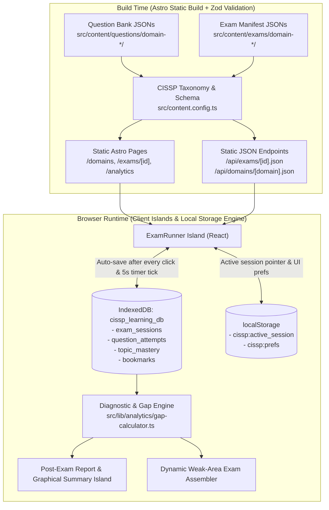
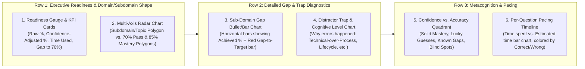

# CISSP Practice & Diagnostic Learning System — Vision & Agent Playbook

**Repository**: `D:\git\learn-cissp`  
**Status**: Canonical Architecture & Agent Execution Guide  
**Stack**: Astro 5 (Static Output) · TypeScript · React 19 Islands · Tailwind CSS v4 · IndexedDB + LocalStorage  
**Persistence Model**: 100% Browser-Based Local Persistence (Zero Backend / No Online Database)

---

## 1. Executive Vision & Core Purpose

This project (`learn-cissp`) is a **diagnostic-first CISSP exam preparation and learning platform** built with **Astro**. Unlike conventional quiz apps that merely report a final percentage score, this system treats every practice question as a **multi-dimensional diagnostic instrument**.

### Core Objectives
1. **Structured Domain & Sub-Domain Exams**:
   - Cover all **8 ISC2 CISSP Common Body of Knowledge (CBK) Domains**.
   - Provide **Sub-Domain Exams** (targeted 15–30 question drills on a single sub-domain, e.g., *Domain 3.6: Cryptography*) and **Full Domain Exams** (comprehensive 50–100 question assessments weighted across all sub-domains of a domain).
   - Support dynamically generated **Weak-Area Remediation Exams** assembled in the browser from the user's historical mistakes.
2. **Self-Indicating Question Data (`JSON`)**:
   - Every question JSON carries rich, machine-actionable metadata ("indicating data"): Domain ID, Sub-domain ID, Micro-Topic ID, Bloom's Cognitive Level, CISSP Perspective (`manager_governance`, `risk_advisor`, etc.), Question Style, Difficulty (`1–5`), Benchmark Time, Tested Concepts, and **Distractor Trap Types** on every wrong option.
3. **Deep Question & Answer Explanations**:
   - Every question includes a comprehensive explanation of the correct answer, **individual rationales for why each distractor (`A`, `B`, `C`, `D`) is wrong or suboptimal**, a **"Think Like a Manager" mindset takeaway**, a concise study directive, and authoritative references (ISC2 CBK, NIST, ISO, etc.).
4. **Granular Strength & Weakness Diagnostics**:
   - Immediately after finishing an exam, the system computes a deep diagnostic profile across Sub-domains, Micro-Topics, Cognitive Levels, Mindset Traps, Confidence vs. Accuracy (metacognition), and Time Pacing so the learner knows **exactly what and how to study next**.
5. **Graphical Performance & Gap Summaries**:
   - Present clear, interactive visual charts after every exam and on the global dashboard: **Sub-Domain Gap Bullet/Bar Charts**, **Mastery Radar Charts**, **Confidence vs. Accuracy Quadrant**, **Cognitive & Trap Breakdown Charts**, and **Pacing Timelines**.
6. **Browser-Only State & Exam Resume/Review**:
   - All active exam sessions, per-question telemetry, pause/resume states, bookmarks, and historical mastery records persist locally in the browser using **IndexedDB** (primary store) and **localStorage** (fast session pointers & UI preferences), augmented with **JSON Export/Import** for backup and cross-device portability.

---

## 2. Decisions at a Glance (Agent Guardrails)

| Area | Decision | Mandatory Rule for Agents |
|---|---|---|
| **Framework** | **Astro 5.x** (`output: 'static'`) | Keep page shells, routing, domain catalogs, and build-time validation in Astro. Use client islands only for stateful UI. |
| **Interactive UI** | **React 19 + TypeScript** (`@astrojs/react`) | Use React islands (`client:only="react"` or `client:load`) for the Exam Runner, Pause/Resume Banner, Review Screen, and Analytics Charts. |
| **Styling** | **Tailwind CSS v4** + CSS custom properties | Support distraction-free exam mode and high-contrast dark/light themes. |
| **Question Storage** | **Astro Content Collections** (`JSON` files + **Zod** schemas) | Every exam and question file MUST pass strict Zod validation during `astro check` and `astro build`. |
| **Client Persistence** | **IndexedDB** (via `Dexie` or `idb`) + **`localStorage`** | Never introduce an external database, server session, or cloud auth. All progress lives in browser storage. |
| **Visualizations** | **Recharts** or **Chart.js / Custom SVG** inside React islands | Every post-exam report MUST render graphical summaries of strengths, weaknesses, and target gaps. |
| **Data Portability** | **JSON Export / Import utility** | Users must be able to export their entire browser storage state to a `.json` file and restore it at any time. |

---

## 3. System Architecture & Data Flow



### Architectural Rules
1. **Zero Server Runtime Dependencies**: The compiled `dist/` folder is 100% static HTML, CSS, JS, and pre-built `.json` payloads. It can run locally or on any static host (GitHub Pages, Cloudflare Pages, Netlify).
2. **Build-Time Schema Enforcement**: An exam or question JSON with a missing option explanation, invalid subdomain ID, or missing diagnostic metadata **must fail the build**.
3. **Instant Auto-Save**: During an exam, every option selection, confidence toggle, option strike-through, bookmark flag, and timer checkpoint is persisted immediately to IndexedDB so closing the browser tab or refreshing never loses a single question's state.

---

## 4. Repository & Directory Structure

Agents scaffolding or modifying `D:\git\learn-cissp` MUST adhere to the following layout:

```text
learn-cissp/
├── AGENTS.md                          # Quick entry point for all AI agents
├── README.md
├── docs/
│   ├── VISION_AND_AGENT_PLAYBOOK.md   # This master vision & architecture specification
│   └── QUESTION_DATA_SPEC.md          # Canonical CISSP taxonomy & JSON question/exam spec
├── astro.config.mjs
├── package.json
├── tsconfig.json
├── src/
│   ├── content.config.ts              # Astro 5 Content Layer + Zod schemas for domains, exams, questions
│   ├── content/
│   │   ├── taxonomy/
│   │   │   └── cissp-cbk-2026.json    # Master 8-Domain → Sub-domain → Micro-Topic registry
│   │   ├── exams/
│   │   │   ├── domain-1/              # Exam manifests (subdomain exams + full domain exams)
│   │   │   │   ├── d1-full-01.json
│   │   │   │   ├── d1-sub-1.1.json
│   │   │   │   └── ...
│   │   │   └── domain-2/ ... domain-8/
│   │   └── questions/
│   │       ├── domain-1/              # Question pools organized by domain/subdomain
│   │       │   ├── d1-sub-1.1-questions.json
│   │       │   ├── d1-sub-1.2-questions.json
│   │       │   └── ...
│   │       └── domain-2/ ... domain-8/
│   ├── lib/
│   │   ├── types/
│   │   │   ├── question.ts            # TypeScript interfaces derived from Zod schemas
│   │   │   ├── session.ts             # ExamSession, QuestionAttempt, PauseState types
│   │   │   └── analytics.ts           # DiagnosticReport, GapMetric, MasteryRecord types
│   │   ├── storage/
│   │   │   ├── db.ts                  # IndexedDB setup (Dexie / idb) & schema migrations
│   │   │   ├── session-store.ts       # Create, auto-save, pause, resume, complete exam sessions
│   │   │   ├── mastery-store.ts       # Rolling topic/subdomain mastery updates
│   │   │   └── backup.ts              # Export/Import full browser progress as validated JSON
│   │   ├── exam-engine/
│   │   │   ├── assembler.ts           # Resolves static exam manifests or dynamically builds remediation exams
│   │   │   ├── shuffler.ts            # Deterministic seeded Fisher-Yates shuffle for questions & options
│   │   │   └── scorer.ts              # Evaluates attempt, computes raw/weighted scores & trap tallies
│   │   └── analytics/
│   │       ├── gap-calculator.ts      # Computes strengths, weaknesses, and target gaps
│   │       ├── metacognition.ts       # Confidence vs. Accuracy quadrant classification
│   │       ├── pacing-analyzer.ts     # Time spent vs. benchmark time diagnosis
│   │       └── study-plan.ts          # Generates prioritized study recommendations from gaps
│   ├── components/
│   │   ├── layout/
│   │   │   ├── AppShell.astro
│   │   │   └── ResumeExamBanner.tsx   # Client island checking IndexedDB/localStorage for active sessions
│   │   ├── catalog/
│   │   │   ├── DomainCard.astro       # Displays domain info + client hydration for mastery % badge
│   │   │   └── ExamSelectorModal.tsx  # Choose Exam Mode (Strict Simulation vs. Study Mode)
│   │   ├── exam-runner/
│   │   │   ├── ExamRunner.tsx         # Core stateful exam interface
│   │   │   ├── QuestionViewport.tsx   # Stem, scenario box, options, option strike-through
│   │   │   ├── ConfidenceSelector.tsx # Low / Medium / High confidence capture per question
│   │   │   ├── QuestionNavigator.tsx  # Grid palette showing Answered, Unanswered, Flagged
│   │   │   └── ExplanationDrawer.tsx  # Rich answer breakdown (shown in Study Mode or Review Mode)
│   │   └── analytics/
│   │       ├── PostExamDashboard.tsx  # Full post-exam diagnostic & review experience
│   │       ├── DomainRadarChart.tsx   # Graphical spider/radar chart of domain/subdomain performance
│   │       ├── SubdomainGapChart.tsx  # Horizontal bullet/bar chart showing gap to 70%/85% target
│   │       ├── ConfidenceMatrix.tsx   # 2x2 Quadrant chart (Mastery, Lucky Guess, Known Gap, Blind Spot)
│   │       ├── TrapBreakdownChart.tsx # Donut/Bar chart of cognitive levels & distractor traps triggered
│   │       ├── PacingTimeline.tsx     # Per-question time vs. benchmark bar chart
│   │       └── StrengthWeaknessTable.tsx # Drill-down table sorted by Priority Gap Index
│   └── pages/
│       ├── index.astro                # Dashboard: Domain overview, Resume banner, Overall Readiness
│       ├── domains/
│       │   └── [domainId].astro       # Domain hub: Sub-domain exams, Full domain exams, Domain mastery
│       ├── exam/
│       │   ├── [examId].astro         # Active exam runner page (supports ?sessionId= for resume)
│       │   └── custom.astro           # Weak-area / custom exam runner page
│       ├── results/
│       │   └── [sessionId].astro      # Post-exam graphical summary, gap diagnostics & deep question review
│       ├── history/
│       │   └── index.astro            # All past attempts, trend charts, Export/Import data manager
│       └── api/
│           ├── exams/
│           │   └── [examId].json.ts   # Static build-time JSON endpoint for exam + hydrated questions
│           └── domains/
│               └── [domainId].json.ts # Static build-time JSON endpoint for domain question pool
```

---

## 5. CISSP Domain & Exam Hierarchy

Every exam and question MUST map to the official 8 ISC2 CISSP domains:

| Domain ID | Official Domain Name | Exam Weight | Sub-Domain Range | Required Exam Types |
|---|---|---|---|---|
| `dom-1` | Security and Risk Management | 16% | `1.1` – `1.12` | Sub-domain exams (`1.1`..`1.12`) + Full Domain 1 Exam |
| `dom-2` | Asset Security | 10% | `2.1` – `2.6` | Sub-domain exams (`2.1`..`2.6`) + Full Domain 2 Exam |
| `dom-3` | Security Architecture and Engineering | 13% | `3.1` – `3.10` | Sub-domain exams (`3.1`..`3.10`) + Full Domain 3 Exam |
| `dom-4` | Communication and Network Security | 13% | `4.1` – `4.3` | Sub-domain exams (`4.1`..`4.3`) + Full Domain 4 Exam |
| `dom-5` | Identity and Access Management (IAM) | 13% | `5.1` – `5.6` | Sub-domain exams (`5.1`..`5.6`) + Full Domain 5 Exam |
| `dom-6` | Security Assessment and Testing | 12% | `6.1` – `6.5` | Sub-domain exams (`6.1`..`6.5`) + Full Domain 6 Exam |
| `dom-7` | Security Operations | 13% | `7.1` – `7.15` | Sub-domain exams (`7.1`..`7.15`) + Full Domain 7 Exam |
| `dom-8` | Software Development Security | 10% | `8.1` – `8.5` | Sub-domain exams (`8.1`..`8.5`) + Full Domain 8 Exam |

### Exam Tiers
1. **Sub-Domain Exam (`examScope: "subdomain"`)**:
   - Focuses exclusively on **one sub-domain** (e.g., `1.4` Risk Analysis, or `3.6` Cryptography).
   - Default length: `15` to `30` questions covering all micro-topics (`1.4.1`, `1.4.2`, etc.) within that sub-domain across difficulty levels `1` through `5`.
2. **Full Domain Exam (`examScope: "domain_full"`)**:
   - Covers **all sub-domains** of a single domain (e.g., all of Domain 1).
   - Default length: `50` to `100` questions distributed proportionally across the domain's sub-domains.
   - Evaluates cross-subdomain synthesis and readiness for that domain.
3. **Weak-Area / Remediation Exam (`examScope: "remediation"`)**:
   - Generated dynamically in the browser from the user's `topic_mastery` and `question_attempts` tables in IndexedDB, pulling missed, low-confidence, or weak-topic questions.

---

## 6. Self-Indicating Question Data Specification (JSON & Zod Contract)

To enable deep diagnostic reporting after each exam, the question JSON **must not** be a flat `{ question, options, answer }` object. It must embed structured **Diagnostic Indicators** so the scoring engine can automatically deduce *what* the user knows, *where* their gaps lie, and *why* they are missing questions.

> See [QUESTION_DATA_SPEC.md](file:///D:/git/learn-cissp/docs/QUESTION_DATA_SPEC.md) for the complete Sub-Domain Taxonomy Registry and annotated sample JSON files.

### 6.1 Zod Schema (`src/content.config.ts`)

Agents must implement the following schema verbatim as the baseline contract:

```typescript
import { z } from 'astro:content';

export const DistractorTrapTypeEnum = z.enum([
  'technical_fix_over_process', // Chose hands-on technical action when a governance/policy/management step was required
  'wrong_lifecycle_phase',      // Chose a valid action, but for the wrong phase (e.g., containment action during recovery)
  'extreme_absolutist',         // Fell for an "always / never / eliminate all risk" distractor
  'confuses_similar_terms',     // Confused sibling concepts (e.g., Due Care vs. Due Diligence, BCP vs. DRP, Biba vs. Bell-LaPadula)
  'solves_wrong_problem',       // Valid security control, but does not address the root requirement in the stem
  'premature_escalation',       // Escalated to law enforcement/regulators before internal validation/management review
  'ignores_human_safety',       // Prioritized data/systems over human life and physical safety
  'cost_disproportionate',      // Selected a control whose cost exceeds asset value / ALE
  'incomplete_partial_answer',  // True statement, but another option encompasses it more broadly
]);

export const CognitiveLevelEnum = z.enum([
  'remember',   // Recall definitions, port numbers, key lengths, standard names
  'understand', // Explain concepts, compare two models
  'apply',      // Execute a formula (SLE/ARO/ALE) or map a control to a scenario
  'analyze',    // Differentiate root cause in a multi-factor scenario
  'evaluate',   // Judge the BEST / MOST / FIRST action among multiple plausible choices
]);

export const CisspPerspectiveEnum = z.enum([
  'manager_governance', // CISO / Management policy & oversight lens
  'risk_advisor',       // Business risk alignment & cost-benefit lens
  'technical_architect',// Security engineering & cryptographic design lens
  'incident_responder', // Forensics, containment & operations lens
  'compliance_auditor', // Legal, regulatory, & third-party audit lens
]);

export const QuestionStyleEnum = z.enum([
  'best_answer',        // "Which of the following is the BEST..."
  'first_action',       // "What should the security manager do FIRST / NEXT..."
  'most_likely',        // "Which is MOST likely to..."
  'least_likely',       // "Which of the following is LEAST appropriate / NOT..."
  'calculation',        // Quantitative calculation (ALE, MTBF, availability %)
  'concept_mapping',    // Direct concept / architecture identification
]);

export const QuestionOptionSchema = z.object({
  id: z.enum(['A', 'B', 'C', 'D']),
  text: z.string().min(1),
  isCorrect: z.boolean(),
  explanation: z.string().min(20, 'Each option requires a detailed explanation of why it is right or wrong.'),
  trapType: DistractorTrapTypeEnum.nullable().default(null), // Required for incorrect options (isCorrect: false)
});

export const QuestionSchema = z.object({
  id: z.string().regex(/^cissp-d[1-8]-s\d+\.\d+-q\d{3,4}$/),
  version: z.number().int().positive().default(1),

  // 1. Hierarchical Taxonomy Indicators
  domainId: z.enum(['dom-1', 'dom-2', 'dom-3', 'dom-4', 'dom-5', 'dom-6', 'dom-7', 'dom-8']),
  subdomainId: z.string().regex(/^[1-8]\.\d{1,2}$/),
  subdomainName: z.string(),
  topicId: z.string().regex(/^[1-8]\.\d{1,2}\.\d{1,2}$/),
  topicName: z.string(),

  // 2. Diagnostic & Cognitive Indicators ("Indicating Data")
  cognitiveLevel: CognitiveLevelEnum,
  perspective: CisspPerspectiveEnum,
  questionStyle: QuestionStyleEnum,
  difficulty: z.union([z.literal(1), z.literal(2), z.literal(3), z.literal(4), z.literal(5)]),
  difficultyLabel: z.enum(['foundational', 'intermediate', 'advanced', 'exam_hard', 'cat_stretch']),
  estimatedTimeSeconds: z.number().int().min(20).max(240).default(75),
  conceptsTested: z.array(z.string()).min(1),
  keyTerms: z.array(z.string()).default([]),
  tags: z.array(z.string()).default([]),

  // 3. Question Content
  stem: z.string().min(30),
  scenarioContext: z.string().nullable().default(null), // Optional background exhibit / table / scenario block
  highlightKeywords: z.array(z.string()).default([]),   // Words like "BEST", "FIRST", "NOT", "PRIMARY" for Review Mode

  // 4. Options (Exactly 4 options, 1 correct)
  options: z.array(QuestionOptionSchema)
    .length(4)
    .refine((opts) => opts.filter((o) => o.isCorrect).length === 1, {
      message: 'Exactly one option must have isCorrect: true',
    })
    .refine((opts) => opts.filter((o) => !o.isCorrect).every((o) => o.trapType !== null), {
      message: 'Every incorrect option (distractor) must specify a non-null trapType for diagnostic analysis',
    }),

  // 5. Comprehensive Explanations & Study Guidance
  explanation: z.object({
    correctOptionId: z.enum(['A', 'B', 'C', 'D']),
    summary: z.string().min(40),
    managerMindsetTip: z.string().min(20),
    studyFocusDirective: z.string().min(20), // Specific actionable instruction if the user misses this question
    keyTakeaway: z.string().min(20),
    references: z.array(
      z.object({
        source: z.string(), // e.g., "ISC2 CISSP Official Study Guide (10th Ed.)" or "NIST SP 800-61r2"
        section: z.string(),
      })
    ).min(1),
  }),
});

export const ExamManifestSchema = z.object({
  examId: z.string(),
  title: z.string(),
  description: z.string(),
  examScope: z.enum(['subdomain', 'domain_full']),
  domainId: z.enum(['dom-1', 'dom-2', 'dom-3', 'dom-4', 'dom-5', 'dom-6', 'dom-7', 'dom-8']),
  subdomainId: z.string().nullable(), // Non-null for "subdomain" exams, null for "domain_full" exams
  timeLimitMinutes: z.number().int().positive(),
  passingScorePercent: z.number().min(50).max(100).default(70),
  masteryScorePercent: z.number().min(70).max(100).default(85),
  questionIds: z.array(z.string()).min(10),
  blueprintWeights: z.record(z.string(), z.number()).optional(), // Subdomain ID -> target percentage for full domain exams
});
```

---

## 7. Browser-Based Persistence Engine (No Online DB)

All user progress, active exams, pause states, and historical analytics live strictly in the browser.

### 7.1 Dual-Storage Strategy
1. **IndexedDB (`cissp_learning_db`)**:
   - Managed via **Dexie.js** (`src/lib/storage/db.ts`).
   - Handles structured querying, historical attempt logs, per-question telemetry, and rolling mastery aggregations without hitting `localStorage` 5MB limits.
2. **`localStorage`**:
   - Stores `cissp:active_session_pointer` (`{ sessionId, examId, examTitle, currentQuestionIndex, totalQuestions, updatedAt }`) so the top navigation bar can synchronously render a **"Resume Exam"** callout with zero layout shift.
   - Stores `cissp:user_preferences` (theme, timer display toggle, default exam mode: `"simulation"` vs. `"study"`).

### 7.2 IndexedDB Table Schemas (`src/lib/storage/db.ts`)

```typescript
export interface ExamSessionRecord {
  sessionId: string;               // Primary Key (UUID v4)
  examId: string;                  // Indexed (e.g., "d1-sub-1.4" or "d1-full-01")
  examTitle: string;
  examScope: 'subdomain' | 'domain_full' | 'remediation';
  domainId: string;                // Indexed
  subdomainId: string | null;      // Indexed
  mode: 'simulation' | 'study';    // 'simulation' = hides answers until end; 'study' = optional instant reveal
  status: 'in_progress' | 'paused' | 'completed' | 'abandoned'; // Indexed

  startedAt: string;               // ISO timestamp
  updatedAt: string;               // ISO timestamp
  completedAt: string | null;

  timeLimitSeconds: number;
  elapsedSeconds: number;          // Flushed every 5 seconds and on pause/visibilitychange
  currentQuestionIndex: number;    // 0-based index so user resumes on the exact question

  questionOrder: string[];         // Shuffled array of question IDs
  optionOrders: Record<string, ('A' | 'B' | 'C' | 'D')[]>; // Per-question shuffled option presentation order

  responses: Record<string, {
    questionId: string;
    selectedOptionId: 'A' | 'B' | 'C' | 'D' | null;
    confidence: 'low' | 'medium' | 'high' | null;
    eliminatedOptionIds: ('A' | 'B' | 'C' | 'D')[]; // Right-click / strike-through state preserved on resume
    isFlagged: boolean;                             // Marked for review before submission
    timeSpentSeconds: number;                       // Accumulated active dwell time on this question
    answeredAt: string | null;
    revealedInStudyMode: boolean;
  }>;

  // Populated upon completion
  diagnosticReport?: DiagnosticReport;
}

export interface QuestionAttemptRecord {
  attemptId: string;               // Primary Key
  sessionId: string;               // Indexed
  examId: string;                  // Indexed
  questionId: string;              // Indexed
  domainId: string;                // Indexed
  subdomainId: string;             // Indexed
  topicId: string;                 // Indexed
  timestamp: string;               // Indexed

  selectedOptionId: 'A' | 'B' | 'C' | 'D' | null;
  correctOptionId: 'A' | 'B' | 'C' | 'D';
  isCorrect: boolean;              // Indexed
  confidence: 'low' | 'medium' | 'high' | null;
  timeSpentSeconds: number;
  estimatedTimeSeconds: number;
  wasFlagged: boolean;

  // Copied from question's indicating metadata for fast aggregation
  cognitiveLevel: string;
  perspective: string;
  questionStyle: string;
  difficulty: number;
  trapTypeTriggered: string | null; // Non-null if isCorrect === false
}

export interface TopicMasteryRecord {
  key: string;                     // Primary Key: e.g., "topic:1.4.2" or "subdomain:1.4" or "domain:dom-1"
  level: 'domain' | 'subdomain' | 'topic';
  domainId: string;                // Indexed
  subdomainId: string | null;      // Indexed
  topicId: string | null;
  name: string;

  totalAttempts: number;
  correctAttempts: number;
  rawAccuracyPercent: number;
  recentWeightedScore: number;     // Exponential moving average weighting recent attempts higher (alpha = 0.35)
  highConfidenceErrors: number;    // Blind spots count
  lowConfidenceCorrects: number;   // Lucky guesses count
  avgTimeRatio: number;            // mean(timeSpent / estimatedTime)
  masteryTier: 'untested' | 'critical_weakness' | 'developing' | 'proficient' | 'mastered';
  gapToTargetPercent: number;      // max(0, 70 - recentWeightedScore)
  lastPracticedAt: string;
}
```

### 7.3 Exam Resume & Review Lifecycle
1. **Starting an Exam**:
   - Before creating a new session for `examId`, check IndexedDB for an existing session with `{ examId, status: 'in_progress' | 'paused' }`.
   - If found, prompt the user: **"Resume existing attempt (Question X of Y, MM:SS remaining)"** or **"Start Fresh Attempt"**.
2. **Continuous Auto-Save & Tab-Close Protection**:
   - Every user interaction (`selectOption`, `setConfidence`, `toggleEliminateOption`, `toggleFlag`, `navigateQuestion`) writes immediately to `db.exam_sessions`.
   - A `document.addEventListener('visibilitychange', ...)` handler automatically pauses the timer and flushes `elapsedSeconds` when the user switches tabs or minimizes the browser.
3. **Explicit Pause**:
   - Clicking **"Pause & Save Exit"** sets `status = 'paused'`, records `updatedAt`, updates `localStorage['cissp:active_session_pointer']`, and redirects to the dashboard where the **Resume Banner** is pinned at the top.
4. **Post-Exam Review Mode**:
   - Any completed session (`status = 'completed'`) can be opened at `/results/[sessionId]` at any time in the future.
   - Review Mode allows filtering the exam's questions by:
     - `All Questions`
     - `Incorrect Only`
     - `High-Confidence Errors (Blind Spots)`
     - `Low-Confidence Correct (Lucky Guesses)`
     - `Flagged for Review`
     - `Slow / Over-Time Questions`
     - `By Sub-Domain / Topic`

---

## 8. Diagnostic Engine: Strength, Weakness & Gap Algorithms

After an exam is submitted, `src/lib/analytics/gap-calculator.ts` runs synchronously over the session's hydrated questions and user responses to produce a `DiagnosticReport`.

### 8.1 Core Formulas

1. **Raw Accuracy ($A$)**:
   $$A = \left(\frac{\text{Correct Count}}{\text{Total Questions}}\right) \times 100$$

2. **Difficulty-Weighted Score ($W$)**:
   Questions carry difficulty $d_i \in \{1, 2, 3, 4, 5\}$.
   $$W = \left(\frac{\sum_{i=1}^{N} \mathbb{I}(\text{correct}_i) \cdot d_i}{\sum_{i=1}^{N} d_i}\right) \times 100$$

3. **Confidence-Adjusted Mastery Score ($M$)**:
   Penalizes high-confidence misconceptions and slightly discounts low-confidence lucky guesses so the user gets an honest measure of exam readiness:
   - Correct + High Confidence = $+1.00$
   - Correct + Medium Confidence / Unset = $+0.90$
   - Correct + Low Confidence (Lucky Guess) = $+0.65$
   - Incorrect + Low Confidence (Known Gap) = $0.00$
   - Incorrect + Medium Confidence / Unset = $-0.10$
   - Incorrect + High Confidence (Blind Spot) = $-0.25$
   $$M = \text{clamp}\left(0, 100, \left(\frac{\sum_{i=1}^{N} \text{score}_i}{N}\right) \times 100\right)$$

4. **Gap to Passing ($G_{\text{pass}}$) & Gap to Mastery ($G_{\text{mastery}}$)**:
   - CISSP Passing Benchmark $T_{\text{pass}} = 70\%$
   - CISSP Target Mastery Benchmark $T_{\text{mastery}} = 85\%$
   $$G_{\text{pass}} = \max(0, 70 - A), \qquad G_{\text{mastery}} = \max(0, 85 - M)$$

5. **Priority Gap Index ($\text{PGI}$) for Study Ordering**:
   Ranks every Sub-domain and Micro-Topic so the most urgent weaknesses appear at the top of the user's study plan:
   $$\text{PGI}_k = \underbrace{(85 - M_k)}_{\text{Mastery Deficit}} \times \underbrace{\left(1 + 0.25 \cdot \text{BlindSpotRate}_k\right)}_{\text{Misconception Multiplier}} \times \underbrace{w_k}_{\text{Subdomain/Topic Weight}}$$

### 8.2 Mastery Tier Classification

Every Sub-domain and Micro-Topic tested in the exam is classified into one of four actionable tiers:

| Mastery Tier | Badge Color | Rule | Study Action Directive |
|---|---|---|---|
| **Mastered (Strength)** | Emerald (`#10b981`) | $A \ge 85\%$ AND $M \ge 80\%$ AND Blind Spots $= 0$ | Maintain via spaced review; ready for exam day. |
| **Proficient** | Blue (`#3b82f6`) | $70\% \le A < 85\%$ AND Blind Spots $\le 1$ | Review missed rationales and lucky guesses to lock in concepts. |
| **Developing (Borderline Gap)** | Amber (`#f59e0b`) | $55\% \le A < 70\%$ OR ($A \ge 70\%$ with $\ge 2$ Lucky Guesses) | Re-read study guide sections for flagged micro-topics and take a Sub-Domain drill. |
| **Critical Weakness (Priority Gap)** | Rose (`#f43f5e`) | $A < 55\%$ OR Blind Spot Rate $> 25\%$ | Deep conceptual study required. Review "Think Like a Manager" tips and redo sub-domain exam. |

### 8.3 Metacognitive Matrix (Confidence vs. Accuracy)

Every answered question is bucketed into one of 4 quadrants:
1. **Solid Mastery** (`isCorrect: true`, `confidence: 'high' | 'medium'`): Verified strength.
2. **Fragile Knowledge / Lucky Guess** (`isCorrect: true`, `confidence: 'low'`): User got the point by luck or elimination—must be surfaced in the weakness report so it isn't ignored!
3. **Known Knowledge Gap** (`isCorrect: false`, `confidence: 'low'`): User knew they didn't know the material.
4. **Dangerous Blind Spot** (`isCorrect: false`, `confidence: 'high'`): User was confident in a wrong mental model. Highlighted in red at the top of the diagnostic report.

---

## 9. Post-Exam Graphical Summary Specification

Every completed exam view (`/results/[sessionId]`) MUST render a visual **Graphical Summary Dashboard** above the detailed breakdown table and question review drawer.

### Required Visual Charts (React Islands)



1. **Chart 1 — Sub-Domain / Topic Gap Bullet Chart (`SubdomainGapChart.tsx`)**:
   - **Purpose**: Visually answers *"Where is my gap and how big is it?"*
   - **Design**: Horizontal bar for each Sub-domain (or Micro-Topic in a Sub-domain exam).
   - **Visual Layers**:
     - Solid colored bar = User's achieved accuracy ($0\% \to A\%$).
     - Hatched / translucent rose segment extending from $A\%$ to $70\%$ (or $85\%$) = **The Exact Gap to Close**.
     - Vertical dashed reference lines at **$70\%$ (Pass Threshold)** and **$85\%$ (Mastery Target)**.
2. **Chart 2 — Multi-Axis Radar / Spider Chart (`DomainRadarChart.tsx`)**:
   - **Purpose**: Shows balance and lopsidedness across all sub-domains in a Full Domain Exam (or micro-topics in a Sub-domain Exam).
   - **Series**:
     - Series A (Filled Emerald/Blue polygon): Current Exam Accuracy %.
     - Series B (Dashed Indigo polygon): User's Historical Rolling Average %.
     - Series C (Dotted Amber ring at 70%): CISSP Passing Boundary.
3. **Chart 3 — Distractor Trap & Cognitive Breakdown (`TrapBreakdownChart.tsx`)**:
   - **Purpose**: Diagnoses *behavioral patterns* behind wrong answers.
   - **Left Panel (Horizontal Bar / Donut)**: Tallies the `trapType` of all incorrect answers (e.g., `technical_fix_over_process: 5`, `confuses_similar_terms: 3`, `wrong_lifecycle_phase: 2`). Includes a plain-English callout explaining the #1 trap the user fell into.
   - **Right Panel (Grouped Bar)**: Accuracy % across Bloom's Cognitive Levels (`Remember`, `Understand`, `Apply`, `Analyze`, `Evaluate`) and CISSP Perspectives (`Manager/Governance`, `Risk Advisor`, `Technical Architect`, etc.).
4. **Chart 4 — Metacognitive Quadrant (`ConfidenceMatrix.tsx`)**:
   - **Purpose**: Visualizes the $2 \times 2$ matrix of Confidence (`High/Med` vs. `Low`) $\times$ Accuracy (`Correct` vs. `Incorrect`).
   - Clicking any quadrant filters the Question Review list below to those exact questions (e.g., clicking **"Blind Spots (4)"** immediately lists the 4 high-confidence wrong answers).
5. **Chart 5 — Pacing & Time-Trap Timeline (`PacingTimeline.tsx`)**:
   - **Purpose**: Shows time spent per question (`Q1..QN`) as vertical bars compared against a horizontal reference line for each question's `estimatedTimeSeconds`.
   - Identifies **Rushed Mistakes** (wrong answer in $< 40\%$ of benchmark time) and **Time-Sink Questions** ($> 150\%$ of benchmark time).

---

## 10. Step-by-Step Instructions for Agents

When an agent is assigned to build or extend this system in `D:\git\learn-cissp`, follow these phases in order:

### Phase 1: Project Scaffold & Content Layer Setup
1. Initialize the Astro 5 project with TypeScript (`strict`), React integration (`@astrojs/react`), and Tailwind CSS v4.
2. Create `src/content/taxonomy/cissp-cbk-2026.json` containing the canonical 8 Domains, Sub-domains, and Micro-Topics (see [QUESTION_DATA_SPEC.md](file:///D:/git/learn-cissp/docs/QUESTION_DATA_SPEC.md)).
3. Implement `src/content.config.ts` with the exact Zod schemas defined in Section 6.1 (`QuestionSchema`, `ExamManifestSchema`).
4. Create static JSON API endpoints (`src/pages/api/exams/[examId].json.ts` and `src/pages/api/domains/[domainId].json.ts`) that join exam manifests with their full question objects at build time.

### Phase 2: Local Persistence & State Engine (`IndexedDB` + `localStorage`)
1. Implement `src/lib/storage/db.ts` using `dexie` (or `idb`) with the three core stores: `exam_sessions`, `question_attempts`, and `topic_mastery`.
2. Implement `src/lib/storage/session-store.ts` with atomic methods:
   - `startOrResumeSession(examManifest, mode)`
   - `recordQuestionUpdate(sessionId, questionId, partialResponse)`
   - `syncTimer(sessionId, elapsedSeconds, currentQuestionIndex)`
   - `pauseSession(sessionId)`
   - `completeSession(sessionId, questions)`
3. Implement `src/lib/storage/backup.ts` for exporting the entire IndexedDB database to a timestamped `cissp-progress-YYYY-MM-DD.json` file and importing/merging it safely.

### Phase 3: Exam Runner & Review UI Islands
1. Build `ExamRunner.tsx` supporting:
   - Keyboard shortcuts (`1-4` or `A-D` to select option, `C` to cycle confidence, `F` to flag, `←/→` to navigate).
   - Right-click or strike-through button on individual options (`A/B/C/D`) to cross out known distractors.
   - Confidence selector (`Low`, `Medium`, `High`) next to the Next/Submit button.
   - Study Mode toggle (optional instant explanation drawer after answering) vs. Strict Simulation Mode (no feedback until exam submission).
   - Auto-save indicator and **"Pause & Exit"** button.

### Phase 4: Diagnostic Engine & Graphical Summary Dashboard
1. Implement `src/lib/analytics/gap-calculator.ts` using the exact formulas in Section 8.
2. Build `PostExamDashboard.tsx` containing:
   - Executive KPI header (Score %, Readiness Status, Confidence-Adjusted Mastery %, Time Pacing summary).
   - The 5 required graphical charts (`SubdomainGapChart`, `DomainRadarChart`, `TrapBreakdownChart`, `ConfidenceMatrix`, `PacingTimeline`).
   - **Focused Study Plan Box**: Automatically generated bullet list of the top 3 Priority Gap topics (`PGI`), their `studyFocusDirective` strings, and a 1-click **"Practice Weak Topics Now (15 Qs)"** button.
   - Interactive Question-by-Question Review Accordion with filter pills (`All`, `Incorrect`, `Blind Spots`, `Lucky Guesses`, `Flagged`, `By Subdomain`) showing the full explanation, per-option rationales, and "Think Like a Manager" callout.

### Phase 5: Question & Exam Authoring Agents
1. Authoring agents producing question packs or domain exams MUST follow [QUESTION_DATA_SPEC.md](file:///D:/git/learn-cissp/docs/QUESTION_DATA_SPEC.md).
2. Every question JSON must pass `npx astro check` with zero schema errors before a task is marked complete.

---

## 11. Definition of Done & Verification Checklist for Agents

Before any agent marks a feature, exam pack, or UI module complete, verify:
- [ ] `astro check` and `astro build` succeed with zero TypeScript or Zod content schema errors.
- [ ] Every question has 4 options, exactly 1 correct option, individual explanations for all 4 options, and a valid `trapType` on all 3 distractors.
- [ ] Starting an exam, answering 3 questions, striking out an option, flagging a question, and refreshing the browser page restores the exact question, remaining timer, strike-throughs, and flags from IndexedDB.
- [ ] Completing an exam renders all 5 graphical summary charts and accurately sorts sub-domains/topics by Priority Gap Index (`PGI`).
- [ ] Exporting browser progress to JSON, clearing browser storage, and importing the JSON restores all historical attempts and mastery metrics identically.
